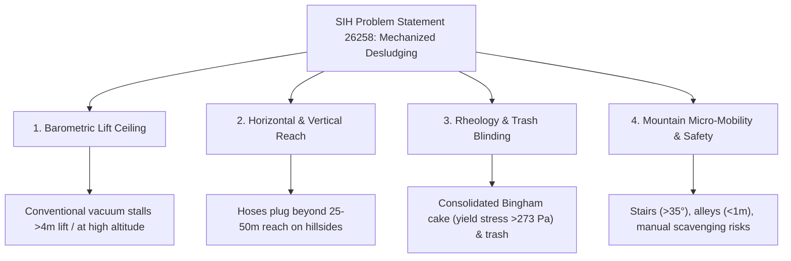
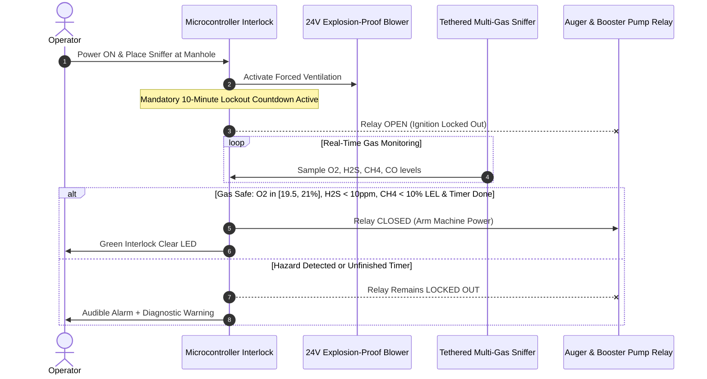
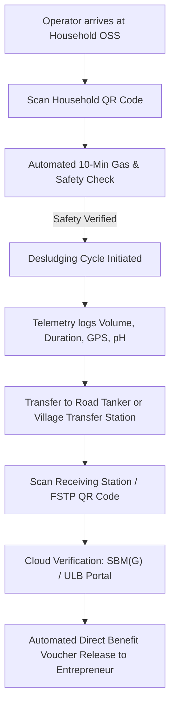

# Engineering Design and Systems Architecture for Mechanized Faecal Sludge Extraction in Varied Climatic Zones and Hilly Terrains

> **Smart India Hackathon (SIH) Problem Statement ID:** 26258  
> **Nodal Ministry:** Ministry of Jal Shakti (MoJS) / Swachh Bharat Mission (Grameen) [SBM(G)]  
> **Focus Domain:** Low-Cost, Portable, and Adaptable Mechanized Desludging Models for Extreme Climatic Zones & Hilly Terrains  
> **Key Benchmark:** 100% Eligible under the ₹5.00 Lakh NAMASTE Scheme Capital Subsidy Ceiling  

---

## Table of Contents
1. [Strategic Context and Problem Deconstruction](#1-strategic-context-and-problem-deconstruction)
   - [1.1 The ODF Plus Challenge and the Sanitation Hardware Bottleneck](#11-the-odf-plus-challenge-and-the-sanitation-hardware-bottleneck)
   - [1.2 Mathematical Quantification of Faecal Sludge Accumulation](#12-mathematical-quantification-of-faecal-sludge-accumulation)
   - [1.3 Mountain Sanitation Infrastructure & The Last-Mile Access Deficit](#13-mountain-sanitation-infrastructure--the-last-mile-access-deficit)
   - [1.4 The Four Interconnected Engineering Challenges](#14-the-four-interconnected-engineering-challenges)
2. [Physics of Extraction Failure: Barometric Limits, Non-Newtonian Rheology, and Climatic Extremes](#2-physics-of-extraction-failure-barometric-limits-non-newtonian-rheology-and-climatic-extremes)
   - [2.1 Barometric and Hydraulic Constraints in Hilly Terrains](#21-barometric-and-hydraulic-constraints-in-hilly-terrains)
   - [2.2 Viscoelasticity and Herschel-Bulkley Rheology of Faecal Sludge](#22-viscoelasticity-and-herschel-bulkley-rheology-of-faecal-sludge)
   - [2.3 Multi-Climatic Zone Failure Matrix](#23-multi-climatic-zone-failure-matrix)
3. [Critical Evaluation of Global and Domestic Mechanized Desludging Prototypes](#3-critical-evaluation-of-global-and-domestic-mechanized-desludging-prototypes)
   - [3.1 Technology Comparison Matrix](#31-technology-comparison-matrix)
   - [3.2 Empirical Lessons from the Flexcrevator and Excluder Evolution](#32-empirical-lessons-from-the-flexcrevator-and-excluder-evolution)
   - [3.3 The Progressive Cavity Pump (PCP) Paradigm Shift](#33-the-progressive-cavity-pump-pcp-paradigm-shift)
4. [Proposed Hardware Architecture: The Tri-Tier "Probe-and-Mule" Hybrid System](#4-proposed-hardware-architecture-the-tri-tier-probe-and-mule-hybrid-system)
   - [4.1 Tier 1: In-Pit Rheological Conditioning and Trash-Excluding Lance ("The Probe")](#41-tier-1-in-pit-rheological-conditioning-and-trash-excluding-lance-the-probe)
   - [4.2 Tier 2: High-Pressure Positive Displacement Booster Module](#42-tier-2-high-pressure-positive-displacement-booster-module)
   - [4.3 Tier 3: All-Terrain Modular Mobility and Climate-Resilient Packaging ("The Mule")](#43-tier-3-all-terrain-modular-mobility-and-climate-resilient-packaging-the-mule)
   - [4.4 Subsystem Engineering Specifications Matrix](#44-subsystem-engineering-specifications-matrix)
5. [Hardware-Interlocked Safety Protocols and Regulatory Compliance](#5-hardware-interlocked-safety-protocols-and-regulatory-compliance)
   - [5.1 Statutory and Legal Framework](#51-statutory-and-legal-framework)
   - [5.2 Automated Hardware-Interlocked Gas and Ventilation Safeguards](#52-automated-hardware-interlocked-gas-and-ventilation-safeguards)
   - [5.3 Ergonomics, Pathogen Barrier, and Chemical Decontamination](#53-ergonomics-pathogen-barrier-and-chemical-decontamination)
6. [Techno-Economic Viability, Bill of Materials, and NAMASTE Scheme Integration](#6-techno-economic-viability-bill-of-materials-and-namaste-scheme-integration)
   - [6.1 Financing Sanitation Entrepreneurship via NAMASTE and SUY](#61-financing-sanitation-entrepreneurship-via-namaste-and-suy)
   - [6.2 Detailed Prototype Bill of Materials (BoM)](#62-detailed-prototype-bill-of-materials-bom)
7. [Digital Traceability and Rural Service Chain Integration](#7-digital-traceability-and-rural-service-chain-integration)
   - [7.1 Low-Bandwidth IoT Telemetry Node](#71-low-bandwidth-iot-telemetry-node)
   - [7.2 QR-Based Verification and Closed-Loop Incentive Release](#72-qr-based-verification-and-closed-loop-incentive-release)
8. [Conclusions and Prototype Implementation Roadmap](#8-conclusions-and-prototype-implementation-roadmap)
9. [Prototype Validation Protocol for Hackathon Execution](#9-prototype-validation-protocol-for-hackathon-execution)
   - [9.1 Stage 1: Rheological Simulant Calibration](#91-stage-1-rheological-simulant-calibration)
   - [9.2 Stage 2: Standardized Solid Waste Stress-Testing (Modified Radford Recipe)](#92-stage-2-standardized-solid-waste-stress-testing-modified-radford-recipe)
   - [9.3 Quantitative Verification Metrics](#93-quantitative-verification-metrics)

---

## 1. Strategic Context and Problem Deconstruction

### 1.1 The ODF Plus Challenge and the Sanitation Hardware Bottleneck
The transition of rural India from Open Defecation Free (ODF) status to comprehensive, safely managed sanitation (ODF Plus) has exposed a critical hardware bottleneck across the sanitation value chain: the safe extraction and transport of faecal sludge from on-site sanitation systems (OSS) located in geographically and climatically extreme environments. 

Formulated by the **Ministry of Jal Shakti (MoJS)** under the **Swachh Bharat Mission (Grameen) [SBM(G)]** as **Smart India Hackathon Problem Statement ID 26258**, the national mandate calls for low-cost, portable, and adaptable mechanized desludging models engineered specifically for varied climatic zones and hilly terrains. 

While software and artificial intelligence themes routinely attract nearly 500 competing submissions per problem statement, this hardware challenge registered only 24 to 34 submissions out of a 500-idea quota prior to its October 2026 deadline. This disparity reflects the formidable multi-physics complexity of handling non-Newtonian biological slurries across steep, vertical topography.

### 1.2 Mathematical Quantification of Faecal Sludge Accumulation
Across low- and middle-income countries, between 2.1 and 2.6 billion people rely on on-site containment systems—such as septic tanks, single pits, twin leach pits, and ventilated improved pit (VIP) latrines—that generate tons of untreated faecal sludge daily. 

In rural districts where on-demand desludging predominates, daily faecal sludge accumulation is quantified by standard central engineering norms using the population-based accumulation formula:

$$\text{FS Capacity (m}^3\text{/day)} = N_{\text{people}} \times 0.00021$$

Alternatively, for scheduled municipal or Gram Panchayat operations, daily volumetric demand is governed by containment geometry and desludging intervals:

$$\text{FS Capacity (m}^3\text{/day)} = \frac{N_{\text{tanks}} \times V_{\text{avg}}}{T_{\text{emptying}} \times D_{\text{operating}}}$$

Where:
- $N_{\text{tanks}}$ = Number of septic tanks in the operational zone
- $V_{\text{avg}}$ = Average containment capacity ($\text{m}^3$)
- $T_{\text{emptying}}$ = Designated emptying interval (years)
- $D_{\text{operating}}$ = Number of active operational service days per year

When these containments fill and cannot be accessed by mechanized equipment, households and informal emptiers resort to manual scavenging with buckets and shovels, or allow tanks to overflow directly into open drains, irrigation fields, and pristine mountain springs. 

> [!WARNING]
> **Severe Public Health Risk:** A single $5\text{ m}^3$ truckload of untreated faecal sludge discharged into the environment delivers a public health pathogen load equivalent to **5,000 people practicing open defecation**.

### 1.3 Mountain Sanitation Infrastructure & The Last-Mile Access Deficit
In India's mountainous states—such as Himachal Pradesh, Uttarakhand, and the North Eastern Region (NER)—state governments are rapidly expanding treatment infrastructure. This is exemplified by:
- **Himachal Pradesh:** Approving 30 Sewage Treatment Plant (STP) co-treatment projects in July 2026 alongside Asian Development Bank (ADB) rural Faecal Sludge Management (FSM) pilots in Sirmaur District.
- **Uttarakhand:** Decentralized waste initiatives across Himalayan towns including Rishikesh, Mussoorie, Kirtinagar, and Joshimath.

However, centralized and decentralized treatment plants remain drastically underutilized if collection machinery cannot bridge the last-mile extraction gap between terraced hillside dwellings and motorable roads. 

Global time-and-motion and serviceability assessments demonstrate that while existing mechanized technologies can empty approximately 75% of improved wet sanitation facilities, a stubborn **25% of facilities remain completely unserviceable** due to two compounding factors:
1. **Severe physical inaccessibility:** Narrow stepped lanes, steep mountain gradients, and dense housing clusters.
2. **Pit matrix consolidation:** High concentrations of non-biodegradable solid waste and consolidated, viscous sludge cakes within the containment.

### 1.4 The Four Interconnected Engineering Challenges
Addressing Problem Statement 26258 requires resolving four interconnected engineering challenges simultaneously within a unified hardware architecture:

1. **Deep-Pit and High-Altitude Vacuum Limitations:** Defeating the barometric suction ceiling that causes conventional vacuum pumps to stall when lifting dense sludge from deep pits or across positive elevation gradients at high altitudes.
2. **Horizontal and Vertical Reach Extension:** Delivering continuous pumping across linear distances far exceeding the $25\text{ m}$ to $50\text{ m}$ limit of standard vacuum hoses without line plugging.
3. **Waterless In-Situ Rheological Conditioning and Trash Exclusion:** Fluidizing consolidated, high-viscosity sludge cakes and rejecting non-biodegradable municipal trash without adding large volumes of scarce freshwater or requiring hazardous manual stirring.
4. **All-Terrain Micro-Mobility with Hardware-Interlocked Safety:** Packaging the extraction, boosting, and containment subsystems onto a modular platform capable of navigating narrow footpaths and $35^\circ$ mountain stairs via two-wheelers, handcarts, or tracked crawlers while physically enforcing operator safety protocols.

---

## 2. Physics of Extraction Failure: Barometric Limits, Non-Newtonian Rheology, and Climatic Extremes

### 2.1 Barometric and Hydraulic Constraints in Hilly Terrains
Conventional mechanized desludging relies almost exclusively on vacuum tanker trucks—colloquially termed "honey suckers"—equipped with sliding vane or liquid ring vacuum pumps. These pumps do not directly draw liquid; rather, they evacuate air from a sealed collection tank to create negative gauge pressure, relying entirely on ambient atmospheric pressure ($P_{\text{atm}}$) at the pit surface to push the sludge column up the suction hose.

Under hydrostatic equilibrium, the theoretical maximum vertical suction lift ($H_{\text{max}}$) is governed by:

$$H_{\text{max}} = \frac{P_{\text{atm,H}} \cdot \eta_{\text{vac}}}{\rho_{\text{sludge}} \cdot g} - h_{\text{friction}} - h_{\text{leak}}$$

Where:
- $P_{\text{atm,H}}$ = Ambient atmospheric pressure at altitude $H$
- $\eta_{\text{vac}}$ = Volumetric efficiency of the vacuum pump (typically $0.85\text{–}0.90$)
- $\rho_{\text{sludge}}$ = Sludge bulk density ($\approx 1,100\text{ kg/m}^3$)
- $g$ = Gravitational acceleration ($9.81\text{ m/s}^2$)
- $h_{\text{friction}}$ = Dynamic viscous friction head loss inside the hose
- $h_{\text{leak}}$ = Head loss from minor coupling leakages and air ingestion

At sea level ($P_{\text{atm}} \approx 101.3\text{ kPa}$), the theoretical maximum lift for pure water ($\rho = 1,000\text{ kg/m}^3$) is $10.3\text{ m}$ ($34\text{ ft}$). In field operations, single-stage vacuum pumps achieve only an 85% to 90% partial vacuum ($\eta_{\text{vac}} \in [0.85, 0.90]$). When combined with bulk sludge densities ($\rho_{\text{sludge}} \approx 1,100\text{ kg/m}^3$), coupling air leakages ($h_{\text{leak}}$), and high viscous pipe friction losses ($h_{\text{friction}}$) inside standard $7.62\text{ cm}$ ($3\text{-inch}$) hoses, the effective vertical lift drops precipitously.

Consequently, standard operating procedures issued by the **Ministry of Housing and Urban Affairs (MoHUA)** and the **Central Public Health and Environmental Engineering Organisation (CPHEEO)** stipulate that:
- A vacuum truck must park within **$25\text{ m}$ linear distance** of a septic tank.
- If linear distance exceeds $25\text{ m}$ with an elevation gain exceeding **$4\text{ m}$**, unassisted vacuum extraction fails and intermediate pumping becomes mandatory.
- Even on flat ground, suction hoses cannot be extended beyond **$50\text{ m}$**.

> [!IMPORTANT]
> **The High-Altitude Penalty:** Atmospheric pressure ($P_{\text{atm,H}}$) decreases exponentially with elevation. Operating at an altitude of **$2,200\text{ m}$** (typical across Himalayan hill stations) reduces ambient barometric pressure by **$\approx 23\%$**, cutting the theoretical water-lift ceiling from $10.3\text{ m}$ to under **$7.9\text{ m}$** before accounting for pump inefficiency or sludge viscosity. When a hillside dwelling is situated $6\text{ m}$ below road level, a road-parked vacuum truck is physically incapable of lifting the septage.

### 2.2 Viscoelasticity and Herschel-Bulkley Rheology of Faecal Sludge
The inability of vacuum systems to empty pits is further dictated by the complex, non-Newtonian fluid mechanics of aged faecal sludge. Within an undisturbed septic tank or leach pit, contents stratify into three distinct zones:
1. **Floating Scum Layer:** Rich in Fats, Oils, and Grease (FOG).
2. **Liquid Supernatant Zone:** Clarified middle wastewater layer.
3. **Consolidated Sludge Bed:** Dense settled solids at the bottom.

According to the Swiss Federal Institute of Aquatic Science and Technology (**Eawag/Sandec**), faecal sludge consistency is categorized across four regimes based on Total Solids (TS) concentration:
- **Liquid:** $\text{TS} < 5\%$ (water-like, readily pumpable)
- **Slurry:** $\text{TS } 5\text{–}15\%$ (viscous, pumpable with friction losses)
- **Semi-Solid:** $\text{TS } 15\text{–}25\%$ (paste-like, non-pumpable by vacuum alone, spadable at upper bounds)
- **Solid:** $\text{TS} > 25\%$ (consolidated cake, completely unpumpable by conventional suction)

Rheological investigations demonstrate that faecal sludge behaves as a shear-thinning, viscoelastic **Bingham pseudo-plastic** fluid governed by the **Herschel-Bulkley model**:

$$\tau = \tau_y + K \dot{\gamma}^n$$

Where:
- $\tau$ = Applied shear stress ($\text{Pa}$)
- $\tau_y$ = Critical yield stress ($\text{Pa}$)
- $K$ = Consistency coefficient ($\text{Pa}\cdot\text{s}^n$)
- $\dot{\gamma}$ = Applied shear rate ($\text{s}^{-1}$)
- $n < 1$ = Flow behavior index (shear-thinning character)

Dynamic oscillatory rheometry on pit latrine sludge reveals that across low shear frequencies, the elastic storage modulus ($G' \approx 3,000\text{ Pa}$) substantially dominates the viscous loss modulus ($G'' \approx 1,000\text{ Pa}$), yielding a low damping factor:

$$\tan \delta = \frac{G''}{G'} \in [0.2, 0.4]$$

Below the critical yield stress—which ranges from $5\text{ Pa}$ in wet VIP latrines to $20.1\text{ Pa}$ in municipal sludges and up to **$273.24\text{ Pa}$** in consolidated raw mixed faecal sludge—the material behaves as a **Hookean elastic solid**. 

When a vacuum hose applies suction without mechanical agitation:
- The sludge below $\tau_y$ deforms elastically and rebounds without flowing.
- The suction creates **"ratholing"**, drawing a narrow cylindrical cone of air and supernatant while leaving the dense bottom cake untouched.
- Controlled laboratory testing with bentonite clay simulants confirms that increasing solids concentration from $3\text{–}7\%$ to $12\%$ reduces vacuum extraction flow rates by more than 50% (dropping from $>3.0\text{ L/s}$ to $<1.5\text{ L/s}$).

Conversely, once the applied mechanical shear exceeds $\tau_y$ (requiring shear rates well above $50\text{ s}^{-1}$), the internal extracellular polymeric substance (EPS) matrix and particle network fracture, causing apparent viscosity to drop exponentially. 

> [!NOTE]
> **Transport Nuance:** While bulk sludge is shear-thinning ($n < 1$), separated liquid leachate or supernatant carrying high suspended biosolid fractions can exhibit **shear-thickening (dilatant) behavior** ($n > 1$) under high-velocity turbulent transport due to repulsive particle-particle interactions. This necessitates precise variable-speed pump control during liquid transfer.

### 2.3 Multi-Climatic Zone Failure Matrix
A viable desludging system must operate across India's diverse hydro-climatic zones. Temperature variations directly alter rheology: low temperatures cause apparent viscosity and inter-particle activation energy to spike, requiring significantly higher shear stress to initiate flow. In arid regions, pour-flush toilets use as little as $0.5\text{ L}$ per flush (vs. $6\text{–}9\text{ L}$ in cistern-flush toilets), leading to rapid soil percolation and hyper-dense, semi-solid sludge cakes ($\text{TS } 15\text{–}25\%$). Diluting this waste by hauling freshwater in drought areas is environmentally and economically unsustainable.

| Climatic & Topographical Zone | Representative Indian Regions | Primary Sludge & Containment Characteristics | Conventional Equipment Failure Modes | Required Hardware Countermeasures |
| :--- | :--- | :--- | :--- | :--- |
| **Cold & High-Altitude Mountainous** | Himachal Pradesh, Uttarakhand, Ladakh, Sikkim, Arunachal Pradesh | Sub-zero winter ambient temperatures; high-viscosity, cold-consolidated sludge; elevated elastic yield stress; indoor or insulated deep containment tanks. | Reduced atmospheric pressure ($P_{\text{atm,H}}$) cuts vacuum lift; freezing of residual water in hoses, valves, and liquid-ring pumps; elastomer embrittlement below $-10^\circ\text{C}$. | Positive-displacement progressive cavity pump Near-Pit Booster; $-10^\circ\text{C}$ to $120^\circ\text{C}$ EPDM/Viton stator; exhaust heat-trace jacketed manifold; compressed-air line purge. |
| **Arid & Water-Scarce Plains / Plateaus** | Western Rajasthan, Kutch, Rayalaseema, Marathwada, Bundelkhand | Low flush water input ($0.5\text{–}2\text{ L}$); high soil percolation; semi-solid to solid cake ($\text{TS } 15\text{–}25\%$); high grit/sand abrasion; yield stress approaching $273\text{ Pa}$. | Vacuum ratholing without sludge extraction; severe pump clogging; excessive freshwater consumption required for manual dilution; rapid vane wear from sand. | High-torque $300\text{ rpm}$ mechanical auger cutter head; closed-loop supernatant recirculation jetting (zero external water); abrasion-resistant tool-steel rotor. |
| **High-Rainfall, Flood-Prone & Coastal** | Assam / NER valleys, Kerala (Wayanad), Bihar plains, Coastal Odisha | High groundwater infiltration diluting upper layers; unlined pits prone to wall collapse ($18\%$ of ordinary pits); overflowing tanks; floating plastic/rag debris. | Heavy vacuum trucks sink in waterlogged clay soils; unlined pit walls collapse under rapid high-vacuum drawdowns; electrical short-circuits in wet conditions. | Low ground-pressure rubber-tracked crawler chassis; variable-frequency drive (VFD) gentle flow control; IP67 sealed motors; active rotating trash excluder. |
| **Steep Terraced Peri-Urban & Rural Hills** | Mussoorie, Shimla, Joshimath, Kirtinagar, Shillong, Aizawl | Containments located down steep stepped footpaths ($>30^\circ$ incline) and narrow alleys ($<1.0\text{ m}$ wide), $30\text{–}150\text{ m}$ away from motorable roads. | Zero vehicular access for $4,000\text{–}11,000\text{ L}$ tankers; elevation differential ($>4\text{ m}$) stalls suction; high risk of vehicle rollover on mountain slopes. | Split "Probe-and-Mule" architecture: $750\text{ mm}$ wide tracked crawler ($35^\circ$ gradeability) + $12\text{–}24\text{ bar}$ booster pumping through $100\text{ m}+$ flexible hose to road tanker. |

---

## 3. Critical Evaluation of Global and Domestic Mechanized Desludging Prototypes

### 3.1 Technology Comparison Matrix
Over the past two decades, research consortia including Eawag/Sandec, North Carolina State University (supported by the Bill & Melinda Gates Foundation), and the Water Research Commission (South Africa and Malawi) have developed various portable pit-emptying devices. A rigorous failure-mode analysis reveals why individual legacy systems fail in the Indian hilly and multi-climatic context:

| Technology / System | Pumping Mechanism | Typical Tank / Container Capacity | Trash & High-Viscosity Handling | Mobility & Hilly Terrain Viability | Relative Capital Cost & Key Limitations |
| :--- | :--- | :--- | :--- | :--- | :--- |
| **Standard Vacuum Truck ("Honey Sucker")** [cite: 8] | Sliding vane or liquid ring vacuum pump ($85\text{–}90\%$ partial vacuum). | $4,000\text{ L}$ to $55,000\text{ L}$ ($11,000\text{ L}$ standard). | **Poor;** clogs on rags/plastics; cannot pump $\text{TS} > 12\%$ without heavy dilution. | **Very poor;** restricted to wide roads; fails if linear distance $>25\text{ m}$ and lift $>4\text{ m}$. | $20\times\text{ to }50\times$ higher than modular systems; high O&M and fuel costs. |
| **The Gulper** [cite: 13, 42] | Manual direct-lift positive displacement pump using butterfly valves. | Discharges into external buckets or $40\text{–}60\text{ L}$ drums. | **Moderate to poor;** butterfly valves jam on synthetic hair, rags, and sanitary pads. | **High portability** (hand-carried), but zero horizontal pumping reach uphill. | Low cost, but labor-intensive, slow, and exposes operators to splatter hazards. |
| **eVac Portable System** [cite: 17, 46, 47] | Portable vane vacuum pump with "suck and blow" pneumatic reversal. | $40\text{ L}$ interchangeable sealed-lid HDPE containers. | **Low;** relies on pure vacuum suction, stalling in consolidated or trash-heavy pits. | **High portability** via handcarts; effective for wet septic tanks ($61\%$ of field tasks). | Limited by atmospheric suction ceiling; high container-swapping labor on steep hills. |
| **Flexcrevator + Excluder (NC State)** [cite: 9, 17, 31] | $1.75\text{ kVA}$ Condé ProVac 3 vacuum pump + $1.2\text{ kVA}$ electric $300\text{ rpm}$ auger excluder. | $90\text{ L}$ vacuum surge cube discharging into $200\text{ L}$ barrels or $500\text{ L}$ tank. | **Excellent trash deflection** via rotating auger and $1.27\text{ cm}$ perforated screen. | **Modular handcart** footprint fits narrow alleys, but lacks self-propelled hill climbing. | $10\times\text{ to }50\times$ cheaper than vac trucks; still struggles with thick sludge under vacuum alone. |
| **Proposed Hybrid "Probe-and-Mule" Model** | $300\text{ rpm}$ solid-shaft cutter-auger + $4\text{ HP}$ Progressive Cavity Booster ($12\text{–}24\text{ bar}$) + Air-Assist. | $90\text{ L}$ surge cube + modular $50\text{ L}$ drums OR $150\text{ m}$ direct hose to road tanker. | **Superior;** mechanical shear + closed-loop supernatant jetting + positive displacement. | **Self-propelled** $750\text{ mm}$ tracked crawler ($35^\circ$ gradeability) or 2-wheeler trailer. | **₹2.10L–₹3.45L** total BoM; fits 100% within ₹5.00L NAMASTE subsidy ceiling. |

### 3.2 Empirical Lessons from the Flexcrevator and Excluder Evolution
The developmental evolution of North Carolina State University's Flexcrevator + Excluder provides foundational engineering lessons. In domestic containments lacking solid waste segregation, non-biodegradable debris is ubiquitous.

Standard laboratory trash testing employs a **modified Radford trash recipe** within a $208\text{–}210\text{ L}$ drum of bentonite simulant, comprising:
- 6 unrolled rolls of toilet paper
- 21 paper towel sheets
- 12 sanitary napkins
- 23 tampons
- 22 personal hygiene items
- 8 clumps of synthetic hair ($250\text{ mm}$ minimum length)
- 32 small biodegradable plastic bags ($30\text{ cm}^2$)
- 11 knotted plastic bags filled with $50\text{ g}$ of sludge simulant

Early Excluder designs using a simple perforated pipe screen clogged almost instantly with wet fibers, while designs using a flexible drive cable suffered from internal fiber binding and cable snapping. The breakthrough **"Design K"** architecture introduced:
1. A **rigid solid drive shaft** operating inside a $7.62\text{ cm}$ ($3\text{-inch}$) tube with $1.27\text{ cm}$ diameter perforations.
2. An **external $300\text{ rpm}$ auger** that deflects macro-trash away from the suction zone.
3. **Internal rotating wiping blades** that continuously shear fibrous material attempting to pass through the screen perforations.

### 3.3 The Progressive Cavity Pump (PCP) Paradigm Shift
Even with the Excluder head, the Flexcrevator remained bottlenecked by its reliance on vacuum suction ($1.75\text{ kVA}$ pump) into a $90\text{ L}$ tank, limiting pumping depth and speed in dense sludges. 

To break this limit, the proposed system introduces an **industrial Progressive Cavity Pump (PCP)** (also known as an eccentric screw or helical rotor pump). A PCP features a single-helix alloy steel rotor turning eccentrically inside a twin-helix elastomer stator:
- **Viscosity Independence:** Generates continuous, pulsation-free positive volumetric displacement handling fluids up to **$100,000\text{ to }1,000,000\text{ cSt}$** and **$50\%$ solids consistency**.
- **Extreme Discharge Head:** Delivers **$12\text{ to }24\text{ bar}$ ($120\text{ to }240\text{ m}$ of head)** on the positive discharge side, completely conquering steep mountain elevations.
- **Suction Capability:** Provides up to **$8\text{ m}$** of positive suction lift at the inlet.

---

## 4. Proposed Hardware Architecture: The Tri-Tier "Probe-and-Mule" Hybrid System

To achieve maximum adaptability across steep Himalayan hills, rural plains, and congested alleys, the monolithic tanker truck design is abandoned in favor of a decoupled, **Tri-Tier "Probe-and-Mule" Modular Architecture**:

```mermaid
graph LR
    subgraph T1["Tier 1: The Probe (In-Pit Lance)"]
        L1["Solid-Shaft Auger (300 rpm)"]
        L2["Wiping Screen (1.27 cm holes)"]
        L3["Closed-Loop Jetting (4-6 bar)"]
        L4["Two-Phase Air-Assist Sparger"]
    end

    subgraph T2["Tier 2: Hybrid Suck-and-Boost Skid"]
        S1["Vacuum Surge Cube (90 L)"]
        S2["Sliding-Vane Vac Pump (1.5 kVA)"]
        S3["Rock Trap Baffle (15 mm)"]
        S4["Progressive Cavity Pump (4 HP, 12-24 bar)"]
    end

    subgraph T3["Tier 3: The Mule (Mobility Chassis)"]
        M1["Rubber Tracked Crawler (750 mm width, 35° climb)"]
        M2["Interchangeable Towable Handcart"]
        M3["Thermal Wrap & Reverse Blow Purge"]
    end

    T1 -->|Short 2-5m Suction Hose| T2
    T2 -->|Mounted on Quick-Release ISO Frame| T3
    T2 -->|100-200m High-Pressure Booster Hose| Tanker["Roadside Vacuum Tanker / Drums"]
```

### 4.1 Tier 1: In-Pit Rheological Conditioning and Trash-Excluding Lance ("The Probe")
The primary pit interface is a lightweight ($<22\text{ kg}$), man-portable extraction lance built into a $7.62\text{ cm}$ ($3\text{-inch}$) OD stainless steel (SS 304/316) assembly:

1. **Solid-Shaft Bidirectional Auger & Internal Wiping Screen:**
   - Powered by a top-mounted $1.2\text{ kVA}$ weather-sealed brushless electric motor (or hydraulic motor) with variable speed control operating at $\approx 300\text{ rpm}$.
   - A central rigid alloy-steel shaft extends an external helical screw $15\text{ cm}$ below the intake nozzle. This screw breaks the floating scum crust and applies localized shear stress ($\tau \gg 273\text{ Pa}$) to the bottom cake, forcing it into its shear-thinning regime.
   - Above the auger, a $25\text{ cm}$ intake section features $1.27\text{ cm}$ ($0.5\text{-inch}$) perforations. The outer auger repels macro-trash, while internal rotating blades wipe the screen wall, shearing hair and paper fibers to prevent clogging.

2. **Closed-Loop Supernatant Recirculation Jetting:**
   - Incorporates a $2.5\text{ cm}$ ($1\text{-inch}$) high-pressure fluidization conduit terminating in two tangential nozzles at the auger tip.
   - In the initial 2 minutes of operation, native liquid supernatant from the middle layer is drawn into the $90\text{ L}$ surge tank. A 3-way manifold valve then redirects this native liquid down the jetting conduit at **$4\text{ to }6\text{ bar}$**.
   - This hydro-excavates and slurries the bottom cake using **zero external freshwater**, conserving water in arid regions and preventing freezing issues in winter.

3. **Pneumatic Two-Phase Air-Injection Riser:**
   - For deep pits ($>6\text{ m}$) or high altitudes with low $P_{\text{atm,H}}$, a $6\text{ mm}$ compressed-air line injects regulated micro-bubbles into the intake throat above the screen.
   - Aerating the sludge lowers its bulk density to **$\rho_{\text{mix}} \approx 600\text{–}750\text{ kg/m}^3$** (substantially below water at $1,000\text{ kg/m}^3$), enabling an initial suction lift of **$10\text{ to }15\text{ m}$**.

4. **Biological Seed Retention Spacer:**
   - Complies with CPHEEO and SBM(G) rules mandating that at least **$25\text{ mm}$ of bottom sludge** remain to preserve anaerobic methanogenic bacteria for continuous tank digestion.
   - Equipped with a $25\text{ mm}$ mechanical foot ring and a pressure-transducer depth gauge that automatically warns the operator when the 95% desludging limit is reached.

### 4.2 Tier 2: High-Pressure Positive Displacement Booster Module
Slurry exits the pit via a short $2\text{ m}$ to $5\text{ m}$ suction hose into the skid-mounted booster module:
- **$90\text{ L}$ Vacuum/Surge Cube:** Mild-steel epoxy-coated pressure/vacuum vessel equipped with a $1.5\text{ kVA}$ reversible sliding-vane vacuum pump providing rapid suction prime ($-0.85\text{ bar}$).
- **Internal Rock Trap:** An integrated $15\text{ mm}$ baffle settles out gravel and heavy debris that pass the lance screen, shielding downstream pump elements.
- **$4\text{ HP}$ Progressive Cavity Pump (PCP):** The surge cube feeds directly into the flooded suction port of the PCP. Driven by a single-phase $3.0\text{ kW}$ motor geared to $200\text{–}500\text{ rpm}$ (to mitigate abrasive sand wear), the alloy-steel rotor and Viton/Nitrile stator generate **$12\text{ to }24\text{ bar}$ of positive discharge pressure**.
- **Hillside Booster Range:** Pushes high-viscosity sludge (up to $25\%$ TS, $100,000\text{ cSt}$, $20\text{ mm}$ solid particle passage) through **$100\text{ to }200\text{ m}$** of lay-flat hose up a **$50\text{ m}$ vertical hillside** directly into a roadside tanker.
- **Fail-Safe Hardware Protections:**
  - *Dry-Run Cutoff:* A capacitive sensor and stator thermal probe cut motor power within **$1.5\text{ seconds}$** if inflow ceases.
  - *Overpressure Bypass:* A spring-loaded **$20\text{ bar}$ relief valve** recirculates sludge back to the surge cube or jetting line if the discharge hose kinks or closes.

### 4.3 Tier 3: All-Terrain Modular Mobility and Climate-Resilient Packaging ("The Mule")
The pumping skid is mounted on an ISO-standard quick-release frame ($950\text{ mm} \times 680\text{ mm}$) adaptable to two mobility platforms:

1. **Mountain Configuration (Tracked Crawler):**
   - Self-propelled mini rubber-tracked crawler with a **$750\text{ mm}$ width**, navigating narrow $1.0\text{ m}$ paths and negotiating **$35^\circ$ stairs/slopes**.
   - Powered by a $48\text{V}$ Lithium Iron Phosphate ($\text{LiFePO}_4$) battery pack or an altitude-tuned $9\text{ HP}$ engine, delivering a **$500\text{ kg}$ payload capacity**.
   - *Operating Modes:* Operates in continuous "Suck-and-Push" booster mode through a $150\text{ m}$ hose to a road tanker; or carries six sealed $50\text{ L}$ HDPE barrels / a $300\text{ L}$ baffled tank for short-distance village shuttling.
2. **Plains & Peri-Urban Configuration (Towable Handcart):**
   - Mounts the identical skid onto a balanced dual-axle pneumatic handcart with a universal pintle hitch for towing behind motorcycles, scooters, or e-rickshaws.
3. **Sub-Zero High-Altitude Winterization ($-10^\circ\text{C}$):**
   - Pump and surge drum are encased in an insulated thermal jacket heated by $24\text{V}$ pads or an engine exhaust copper heat-exchanger loop.
   - At job completion, the vane pump is switched to positive-pressure "blow" mode, purging all liquid out of lines to eliminate freezing and ice plugs.

### 4.4 Subsystem Engineering Specifications Matrix

| Subsystem Module | Component & Material Specification | Key Operating Parameters | Target Mass | Target Environmental / Climatic Rating |
| :--- | :--- | :--- | :--- | :--- |
| **Tier 1: In-Pit Extraction Lance** | SS 316 tube ($7.62\text{ cm}$ OD); $1.27\text{ cm}$ screen holes; solid alloy shaft; external/internal auger. | $1.2\text{ kVA}$ sealed electric/hydraulic drive; $300\text{ rpm}$ bidirectional rotation; $25\text{ mm}$ spacer foot. | $21\text{ kg}$ | Submersible IP68; handles $\text{TS up to } 25\%$ and full Radford macro-trash load. |
| **Tier 1: Fluidization & Air-Assist** | Dual tangential $6\text{ mm}$ supernatant jets + $6\text{ mm}$ pneumatic air-injection sparger ring. | Jet pressure: $4\text{–}6\text{ bar}$ recirculated supernatant; Air injection: $2\text{–}3\text{ bar}$ ($150\text{ L/min}$). | $4\text{ kg}$ (hose bundle) | Zero external water consumption; reduces riser density to $<750\text{ kg/m}^3$. |
| **Tier 2: Vacuum Priming & Surge Cube** | $90\text{ L}$ epoxy-coated mild steel pressure/vacuum vessel + $1.5\text{ kVA}$ sliding vane pump. | Vacuum: $-0.85\text{ bar}$ priming; Positive blow purge: $+1.5\text{ bar}$; $15\text{ mm}$ internal stone trap. | $42\text{ kg}$ | Two-stage float ball shutoff + vacuum/pressure relief valves. |
| **Tier 2: Progressive Cavity Booster** | Single-stage or two-stage helical alloy steel rotor; Viton / EPDM metal-bonded elastomer stator. | $4\text{ HP}$ ($3.0\text{ kW}$); Flow: $150\text{–}300\text{ L/min}$ ($9\text{–}18\text{ m}^3\text{/hr}$); Discharge head: $12\text{–}24\text{ bar}$ ($120\text{–}240\text{ m}$). | $58\text{ kg}$ | $-10^\circ\text{C}$ to $+120^\circ\text{C}$ operating range; capacitive dry-run & $20\text{ bar}$ relief bypass. |
| **Tier 3: Tracked Crawler Chassis** | $180\text{ mm}$ rubber tracks; $750\text{ mm}$ total width; hydraulic/electric skid-steer; foldable outriggers. | Gradeability: $35^\circ$ ($70\%$ slope); Speed: $0\text{–}5\text{ km/h}$; Payload: $500\text{ kg}$. | $185\text{ kg}$ | Amphibious mud/snow track profile; $25^\circ$ roll/pitch inclinometer alarm. |

---

## 5. Hardware-Interlocked Safety Protocols and Regulatory Compliance

### 5.1 Statutory and Legal Framework
Manual entry into sewers and septic tanks is strictly prohibited in India under **Section 7 of the Prohibition of Employment as Manual Scavengers and their Rehabilitation Act, 2013**:
- **First Offense:** Up to 2 years imprisonment and a ₹2 lakh fine.
- **Subsequent Offenses:** Up to 5 years imprisonment and a ₹5 lakh fine.

Despite these legal prohibitions and the 2019 MoHUA directive creating Emergency Response Sanitation Units (ERSUs), parliamentary disclosures confirmed that **498 sanitation workers died** cleaning sewers and septic tanks between 2019 and June 2026. Over 90% of fatalities involved workers lacking essential safety equipment. Because administrative rules and checklists are frequently neglected in informal operations, this architecture translates safety mandates directly into **automated hardware interlocks**.

### 5.2 Automated Hardware-Interlocked Gas and Ventilation Safeguards
CPHEEO standard operating procedures mandate opening the manhole, ventilating the pit for 10–15 minutes, and testing for toxic gases before any work begins. The system enforces this through a hardwired safety circuit:

- **Gas Sensor Array:** Real-time monitoring of Oxygen ($\text{O}_2$), Hydrogen Sulfide ($\text{H}_2\text{S}$), Methane ($\text{CH}_4$), and Carbon Monoxide ($\text{CO}$).
- **Forced Ventilation Interlock:** A $24\text{V}$ explosion-proof blower runs for a compulsory 10-minute countdown.
- **Solid-State Lockout Relay:** The auger and PCP booster motors are physically disabled until the controller verifies:
  - $\text{O}_2 \in [19.5\%, 21.0\%]$
  - $\text{H}_2\text{S} < 10\text{ ppm}$
  - $\text{CH}_4 < 10\%\text{ LEL}$ (Lower Explosive Limit)
  - $\text{CO} < 25\text{ ppm}$

### 5.3 Ergonomics, Pathogen Barrier, and Chemical Decontamination
1. **Davit Tripod & Remote Pendant:** The extraction lance is suspended from a lightweight, foldable aluminum A-frame davit tripod positioned over the pit. The operator controls lance depth, auger speed, and jetting via a **$5\text{ m}$ pendant cable or wireless IP67 remote**, standing safely upwind without leaning over the pit.
2. **Dry-Break Cam-Lock Couplings:** All hose connections utilize stainless steel dry-break cam-locks, preventing pathogen leakage and skin contact during decoupling.
3. **Integrated Decontamination Unit:** The chassis features a $15\text{ L}$ pressurized tank with a spray wand delivering a **1% chlorine disinfectant solution**, alongside a $5\text{ kg}$ hydrated lime hopper and sorbent pads for immediate spill mitigation. The system prompts the operator to disinfect fittings before completing the job log.
4. **Onboard PPE Locker & Stability Interlocks:** Weatherproof storage accommodates full CPHEEO-compliant PPE for a 3-person crew (nitrile chemical gauntlets, steel-toe gumboots, full-face splash shields, gas-cartridge respirators, fluorescent jackets). Fold-down leveling outriggers and mechanical track chocks must engage limit switches before the high-pressure pump can run on slopes.

---

## 6. Techno-Economic Viability, Bill of Materials, and NAMASTE Scheme Integration

### 6.1 Financing Sanitation Entrepreneurship via NAMASTE and SUY
To scale sustainably across rural Gram Panchayats and hilly Urban Local Bodies (ULBs), capital expenditure must match existing government subsidy frameworks:
- **NAMASTE Scheme:** National Action for Mechanized Sanitation Ecosystem (jointly launched by the Ministry of Social Justice and Empowerment and MoHUA; expanded to rural India in August 2026 with a **₹498.73 crore outlay** through 2030–31).
- **Swachhta Udyami Yojana (SUY):** Enables sanitation workers to transition into self-employed "Swachhta Udyamis" (Sanitation Entrepreneurs).
- **Subsidy Entitlement:** Provides an upfront capital subsidy of **up to ₹5.00 lakh** per unit, plus bank tie-ups and a mandatory ₹10 lakh life insurance coverage.

Parliamentary audits revealed that out of 58,000 identified manual scavengers, only 2,652 mechanization projects had been approved due to high bank loan rejections for conventional ₹15–₹25 lakh vacuum trucks. 

By designing the Tri-Tier system around domestic industrial manufacturing clusters—notably the progressive cavity pump OEM hubs in **Coimbatore, Mumbai, and Kanpur**—the complete Bill of Materials (BoM) is kept between **₹2.10 lakh and ₹3.45 lakh**.

> [!TIP]
> **Zero Debt Barrier:** Because both variants sit well below the **₹5.00 Lakh NAMASTE capital subsidy ceiling**, sanitation entrepreneurs and self-help groups can acquire the turnkey system without burdensome commercial bank debt.

### 6.2 Detailed Prototype Bill of Materials (BoM)

The engineering Bill of Materials below itemizes production costs for both mobility configurations based on verified domestic industrial component rates:

| Subsystem Category | Detailed Component Description | Source / Specification Benchmark | Unit Cost — Handcart / 2-Wheeler Variant (₹ INR) | Unit Cost — Tracked Mountain Crawler Variant (₹ INR) |
| :--- | :--- | :--- | :--- | :--- |
| **Primary Positive-Displacement Booster** | $4\text{ HP}$ Single-Phase Progressive Cavity Pump ($24\text{ kg/cm}^2$ / $24\text{ bar}$ max pressure, Viton/Nitrile metal-bonded stator, alloy steel rotor, mechanical seal) | Chemech / Floroxi / Flosys Coimbatore & Mumbai OEMs | ₹50,000 | ₹50,000 |
| **In-Pit Trash Excluder & Auger Lance** | SS 316 $7.62\text{ cm}$ tube with $1.27\text{ cm}$ perforations, solid alloy shaft, $300\text{ rpm}$ external/internal auger, $1.2\text{ kVA}$ sealed motor with rheostat, $25\text{ mm}$ spacer foot | NC State Excluder Design K architecture | ₹32,000 | ₹32,000 |
| **Vacuum Priming & Surge Cube Module** | $90\text{ L}$ epoxy-lined steel vacuum surge tank with two-stage float shutoff, stone trap, and $1.5\text{ kVA}$ reversible sliding-vane vacuum/air-injection pump | Flexcrevator / eVac suck-and-blow specification | ₹38,000 | ₹38,000 |
| **Hoses, Jetting Loop & Cam-Lock Manifold** | $50\text{ m}$ of $7.62\text{ cm}$ ($3\text{-inch}$) flexible PVC/nitrile booster hose, $5\text{ m}$ suction hose, SS cam-lock dry-break couplings, 3-way supernatant valve, $20\text{ bar}$ relief bypass | Standard industrial FSM specification | ₹28,000 | ₹35,000 *(includes $100\text{ m}$ hill hose)* |
| **Mobility Undercarriage & Prime Mover** | **Variant A:** Dual-axle pneumatic handcart with 2-wheeler tow hitch + $5\text{ kVA}$ portable genset. **Variant B:** $750\text{ mm}$ wide rubber-tracked crawler chassis ($35^\circ$ gradeability) + onboard engine/battery pack & outriggers | Mini tracked dumper & rural towable specifications | ₹35,000 | ₹1,45,000 |
| **Hardware Safety, Gas Interlock & Cold Kit** | Multi-gas sensor ($\text{O}_2, \text{H}_2\text{S}, \text{CH}_4, \text{CO}$), solid-state relay lockout, $2\text{ m}$ portable air blower, $15\text{ L}$ 1% chlorine sprayer, thermal stator heating pad, 3-crew PPE kit, 6 sealed $50\text{ L}$ HDPE barrels | CPHEEO / MoHUA SOP & cold-climate requirements | ₹27,000 | ₹45,000 |
| **Total Complete System Cost** | **Turnkey Ready-to-Deploy Mechanized Desludging Unit** | **100% Eligible under ₹5.00 Lakh NAMASTE Subsidy** [cite: 50] | **₹2,10,000** | **₹3,45,000** |

---

## 7. Digital Traceability and Rural Service Chain Integration

### 7.1 Low-Bandwidth IoT Telemetry Node
In rural Gram Panchayats where private sector logistics are thin, sustaining long-term operations requires digital oversight. The crawler chassis integrates an ultra-low-power micro-telemetry unit (cellular GSM/GPRS with offline flash buffer):
- **Automated Sensor Telemetry:** Automatically records GPS coordinates, gas safety clearance verification, operating pressure, and septage pH.
- **Accurate Volumetric Accounting:** Measures pumped volume dynamically via progressive cavity pump shaft tachometer revolutions, bypassing easily clogged liquid flowmeters.

### 7.2 QR-Based Verification and Closed-Loop Incentive Release
1. **Household Check-In:** The operator scans a geotagged household QR code to initiate the mandatory gas clearance cycle.
2. **Offloading Check-Out:** Upon arriving at the designated FSTP, STP co-treatment facility, or GOBARdhan bio-methanation unit, the operator scans the facility QR code.
3. **Direct Benefit Payout:** Matching collection GPS with verified discharge GPS triggers digital release of operational service subsidies, closing the loop against illegal roadside dumping.

---

## 8. Conclusions and Prototype Implementation Roadmap

The recurring failure of conventional desludging technology in hilly and multi-climatic environments is rooted in physical law:
- **Barometric ceiling:** Ambient air pressure cannot lift dense slurries up vertical mountain gradients, especially at altitudes where atmospheric pressure is diminished.
- **Rheological barrier:** Shear-thinning, high-yield-stress sludge ($\tau_y > 273\text{ Pa}$) resists unassisted suction, creating ratholes and pump blockages.

The **Tri-Tier "Probe-and-Mule" Architecture** breaks these constraints through four foundational innovations:
1. **Rotary Shear & Deflection:** A $300\text{ rpm}$ solid-shaft auger and perforated wipe-screen deflect macro-trash while liquefying the Bingham plastic sludge cake.
2. **Zero-Water Fluidization:** Closed-loop supernatant recirculation fluidizes dense solids using native pit liquor, conserving freshwater in drought zones and cold climates.
3. **Positive Displacement Hillside Boosting:** A $4\text{ HP}$ Progressive Cavity Pump delivers $12\text{ to }24\text{ bar}$ of positive pressure, boosting slurry through $150\text{ m}+$ hoses up $35^\circ$ inclines.
4. **Physical Safety Interlocks:** Multi-gas sniffers and timed blowers enforce CPHEEO safety procedures at the circuit level before motors can turn.

At **₹2.10 lakh to ₹3.45 lakh**, this domestically manufacturable hardware bridges the last mile between inaccessible mountain dwellings and modern treatment plants, completely eliminating manual scavenging under the national **ODF Plus** mandate.

---

## 9. Prototype Validation Protocol for Hackathon Execution

To validate a **Technology Readiness Level 6 (TRL-6)** prototype safely without biohazard exposure, hackathon engineering teams must execute a two-stage laboratory protocol grounded in international FSM test standards:

### 9.1 Stage 1: Rheological Simulant Calibration
Prepare $208\text{ L}$ test drums of water-bentonite clay suspensions:
- **Thin Slurry Calibration ($3\text{–}7\%$ solids):** Simulates wet septic sludge. Benchmark baseline flow at **$>3.0\text{ L/s}$**.
- **Consolidated Sludge Calibration ($9\text{–}12\%$ solids):** Simulates high-yield-stress aged pit sludge. Measure baseline suction drop ($<1.5\text{ L/s}$), then engage closed-loop supernatant jetting to verify flow rate restoration to **$>2.5\text{ L/s}$**.

### 9.2 Stage 2: Standardized Solid Waste Stress-Testing (Modified Radford Recipe)
Seed the $208\text{ L}$ bentonite drum with the complete modified Radford trash recipe:
- 6 unrolled toilet paper rolls
- 21 paper towel sheets
- 12 sanitary napkins & 23 tampons
- 22 personal hygiene items
- 8 clumps of $250\text{ mm}$ synthetic hair
- 32 small plastic bags ($30\text{ cm}^2$)
- 11 knotted bags filled with $50\text{ g}$ of bentonite

### 9.3 Quantitative Verification Metrics
Operate the lance at $300\text{ rpm}$ while pumping through a $50\text{ m}$ hose routed up a $10\text{ m}$ vertical scaffold (or throttled against an adjustable $5\text{–}10\text{ bar}$ backpressure valve simulating a $50\text{–}100\text{ m}$ elevation rise):
1. **Volumetric Flow Rate:** Verify continuous discharge of **$150\text{–}300\text{ L/min}$** ($9\text{–}18\text{ m}^3\text{/hr}$).
2. **Specific Energy Consumption:** Maintain energy demand below **$1.5\text{ kWh/m}^3$** of extracted slurry.
3. **Clog-Free Run Time:** Achieve 60 minutes of continuous operation without screen blinding, fiber binding, or manual intervention.
