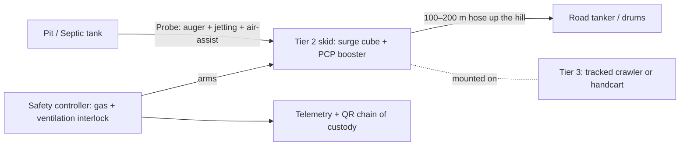

# 01 · Problem Statement and Project Understanding

| Field | Value |
| :--- | :--- |
| SIH Problem Statement ID | **26258** |
| Nodal body | Ministry of Jal Shakti (MoJS) — Swachh Bharat Mission (Grameen) [SBM(G)] |
| Theme | Hardware — low-cost, portable, adaptable mechanized desludging for varied climatic zones and hilly terrains |
| Our solution | **Tri-Tier "Probe-and-Mule"** modular desludging system + **Web3D digital-twin simulation** |
| Source research | [`information.md`](../information.md) (full technical report) |

---

## 1. The problem in one paragraph

Rural India is moving from **ODF** (Open Defecation Free) to **ODF Plus** (safely managed sanitation). Toilets now exist, but the pits and septic tanks behind them fill up and must be emptied. Treatment plants are being built in hill states, yet **the sludge cannot reach them**. A vacuum truck ("honey sucker") cannot drive down a 1 m wide stepped lane, cannot lift thick sludge more than about 4 m above the pit, and loses suction at altitude. About **25% of containments stay unserviceable**, and families fall back on **manual scavenging**, which is illegal and often fatal, or on overflow into springs and drains.

## 2. Why it is hard: four coupled constraints

| # | Constraint | Physical cause | Consequence today |
| :--- | :--- | :--- | :--- |
| C1 | **Barometric lift ceiling** | Vacuum pumps rely on atmospheric pressure to push sludge up the hose. At 2,200 m, Patm ≈ 77.5 kPa (−23%). | Effective lift for 1,100 kg/m³ sludge falls to ≈ 6 m. Trucks stall when lift is above ≈ 4 m. |
| C2 | **Reach** | Suction hoses plug beyond 25–50 m because friction is high with non-Newtonian sludge. | Dwellings 30–150 m from the road are out of reach. |
| C3 | **Rheology and trash** | Aged sludge is a yield-stress (Herschel–Bulkley) material, with τy up to ≈ 273 Pa. Pits also contain rags, pads, hair and plastic. | Suction "ratholes" through the sludge and screens blind. Operators add scarce water or stir by hand. |
| C4 | **Mobility and safety** | Stairs steeper than 35°, lanes under 1 m wide, toxic gases (H₂S, CH₄, CO) and low O₂ in pits. | Trucks can't get there, and workers die. The report cites 498 deaths from 2019 to June 2026. |

These constraints interact. For example, adding water to beat C3 makes the load heavier for C2 and C4, and is not possible in arid zones. A single fix therefore fails, and the solution has to address all four at once.

## 3. Who is affected (stakeholders)

| Stakeholder | Need | What success looks like for them |
| :--- | :--- | :--- |
| Households in hill and remote villages | Pit emptied safely, affordably and on time | No overflow, and no request to a manual scavenger |
| Sanitation workers / *Swachhta Udyamis* (entrepreneurs) | A safe machine they can afford and earn from | Machine within the ₹5 L NAMASTE subsidy, no debt, no pit entry |
| Gram Panchayats / ULBs | Service coverage, compliance, data | Records of every job: where it happened and where the sludge was dumped |
| FSTP / STP / GOBARdhan operators | Steady sludge inflow | Verified deliveries, no illegal dumping |
| MoJS / SBM(G) / MoSJE (NAMASTE) | Scalable, fundable hardware | Domestically manufacturable, subsidy-eligible, replicable design |
| SIH evaluators | A credible, demonstrable solution | Working prototype or validation evidence, plus a convincing simulation |

## 4. Climatic and terrain zones we must serve

| Zone | Example regions | Main challenge | Our key countermeasure |
| :--- | :--- | :--- | :--- |
| Cold / high-altitude | HP, Uttarakhand, Ladakh, Sikkim, Arunachal | Low Patm, freezing, stiff sludge | PCP booster, air-assist, heat jacket, blow-purge |
| Arid / water-scarce | W. Rajasthan, Kutch, Bundelkhand | Semi-solid cake (TS 15–25%), sand | Auger shear plus **zero-freshwater** supernatant jetting |
| High-rainfall / flood | Assam, Kerala, Bihar, coastal Odisha | Soft ground, collapsing pits, debris | Low ground-pressure tracks, VFD soft draw-down, IP67 |
| Steep terraced hills | Shimla, Mussoorie, Shillong, Aizawl | Stairs, narrow lanes, 30–150 m from road | 750 mm crawler plus a 100–200 m booster hose to the road tanker |

## 5. Our solution at a glance

1. **Probe (Tier 1).** A man-portable in-pit lance. A 300 rpm auger and a wiping screen break the sludge cake and reject trash. Closed-loop jetting with the pit's own supernatant fluidizes the sludge without fresh water. Air-assist lightens the column in deep pits.
2. **Booster (Tier 2).** A vacuum surge cube primes the line. A progressive cavity pump (PCP) then *pushes* sludge with positive pressure, so the barometric ceiling no longer applies.
3. **Mule (Tier 3).** A quick-release frame fits either a 750 mm rubber-tracked crawler (35° gradeability) or a 2-wheeler-towable handcart.
4. **Safety by hardware.** Pumps physically cannot start until ventilation has run for 10 minutes and gas readings are safe.
5. **Digital chain of custody.** QR check-in at the household, telemetry during the job, QR check-out at the treatment plant, and automatic subsidy release after that.
6. **Web3D simulation.** A browser-based digital twin. It shows how the system works, lets us test it across zones before building hardware, and trains operators. See [`simulation/`](simulation/README.md).

## 6. Scope

**In scope**
- Engineering design of all three tiers and the safety controller
- Engineering calculations and the operating envelope
- Bill of materials and subsidy fit
- Telemetry and the QR traceability concept
- Lab validation protocol (bentonite simulant plus modified Radford trash)
- Web3D simulation: engineering sandbox, training mode and demo mode

**Out of scope for the hackathon**
- Sludge treatment (FSTP design)
- Road tanker design
- Field trials with real faecal sludge
- Certification (BIS / PESO / ATEX)
- Production tooling

## 7. Success criteria (hackathon)

| ID | Criterion | Target | Evidence |
| :--- | :--- | :--- | :--- |
| SC-1 | Flow from 9–12% TS simulant after jetting | ≥ 2.5 L/s at the lance | Stage-1 test log |
| SC-2 | Clog-free run with full Radford trash | 60 min, no manual intervention | Stage-2 test video |
| SC-3 | Delivery against head | Continuous flow at 5–10 bar back-pressure | Test log + PCP tachometer |
| SC-4 | Specific energy | < 1.5 kWh/m³ | Power logger |
| SC-5 | Interlock | Motors cannot run without 10 min ventilation and safe gas | Fault-injection test |
| SC-6 | Cost | BoM ≤ ₹5.00 L (target ₹2.1–3.45 L) | Costed BoM |
| SC-7 | Simulation | All 4 zone scenarios run in-browser at ≥ 30 FPS on a mid-range laptop. Physics matches the hand calculations within ±10%. | Demo + automated test report |

## 8. Key assumptions to confirm

These assumptions come from the source report and are not yet verified. The team should check them against official sources before submission:
- Statistics: submission counts, 498 deaths (2019 to June 2026), the NAMASTE rural expansion and ₹498.73 cr outlay, 2,652 approved projects
- The ₹5.00 L capital-subsidy ceiling under NAMASTE / SUY
- Vendor price quotes in the BoM (Coimbatore, Mumbai and Kanpur PCP OEMs)

See [04 · Engineering Calculations §7](04-engineering-calculations.md#7-design-consistency-review) for **engineering inconsistencies found in the source report** that must be resolved.
