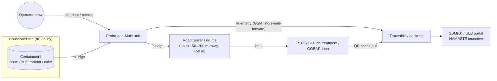
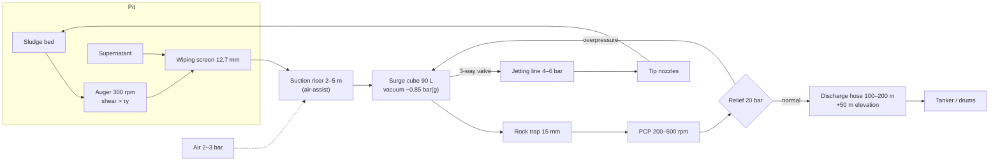
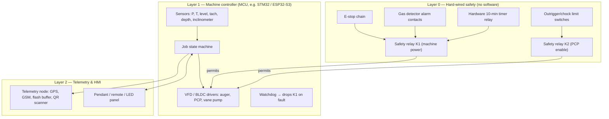
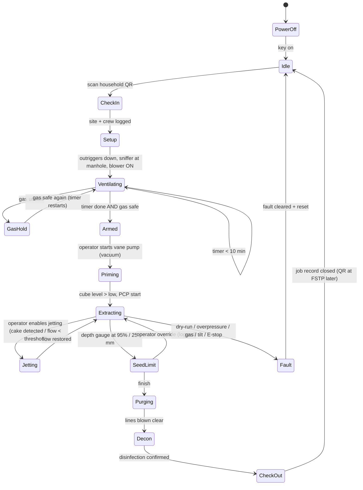

# 03 · System Architecture

The Tri-Tier **"Probe-and-Mule"** system has three hardware tiers plus two support layers:

- **Tier 1 — Probe.** Breaks up the sludge in the pit and draws it in.
- **Tier 2 — Booster.** Moves the sludge up the hill under positive pressure.
- **Tier 3 — Mule.** Carries everything there.
- **Safety and control layer.** Decides when the machine is allowed to run.
- **Digital layer.** Records what happened.

---

## 1. Context diagram



## 2. Physical decomposition

```mermaid
graph TD
    U["Probe-and-Mule Unit"] --> T1["Tier 1: Probe"]
    U --> T2["Tier 2: Booster Skid"]
    U --> T3["Tier 3: Mule"]
    U --> SC["Safety Controller"]
    U --> TN["Telemetry Node"]

    T1 --> T1a["Lance body SS316 Ø76.2"]
    T1 --> T1b["Auger + wiping screen"]
    T1 --> T1c["Jetting nozzles ×2"]
    T1 --> T1d["Air sparger ring"]
    T1 --> T1e["Spacer foot + depth transducer"]
    T1 --> T1f["Davit tripod + winch"]

    T2 --> T2a["90 L surge cube + rock trap"]
    T2 --> T2b["Reversible sliding-vane pump"]
    T2 --> T2c["PCP booster + drive"]
    T2 --> T2d["3-way jetting valve"]
    T2 --> T2e["Relief valve + pressure transmitter"]
    T2 --> T2f["Hose reels + cam-locks"]

    T3 --> T3a["Tracked crawler (Variant B)"]
    T3 --> T3b["Handcart (Variant A)"]
    T3 --> T3c["ISO quick-release frame"]
    T3 --> T3d["Power: LiFePO₄ 48 V or genset"]
    T3 --> T3e["Thermal jacket + heaters"]
    T3 --> T3f["Decon kit + PPE locker"]

    SC --> SCa["Gas detector O₂/H₂S/CH₄/CO"]
    SC --> SCb["Ex-proof blower 24 V"]
    SC --> SCc["Safety relays + E-stop chain"]
    SC --> SCd["Limit switches, inclinometer"]
```



## 3. Process flow (fluid path)



**The key idea.** The vacuum is used **only to prime** the short pit-side suction leg, which is 2–5 m long and lifts ≤ 6 m. Everything after the surge cube is moved by **positive displacement**. Discharge pressure therefore doesn't depend on atmospheric pressure, so altitude only affects the short suction leg (see [04 §2](04-engineering-calculations.md#2-barometric-suction-limit-vs-altitude)).

## 4. Operating modes

| Mode | Use | Flow path |
| :--- | :--- | :--- |
| **M1 Booster ("Suck-and-Push")** | Hill sites where the pit is far below the road | Pit → cube → PCP → long hose → road tanker |
| **M2 Shuttle** | Short village distances, no tanker access | Pit → cube → PCP → onboard 6 × 50 L drums or 300 L tank |
| **M3 Vacuum-only** | Thin, wet septic tanks close by | Pit → cube (vane pump), cube emptied by PCP afterwards |
| **M4 Purge / Winter** | End of job, cold climates | Vane pump in blow mode pushes liquid out of all lines |

## 5. Control architecture

### 5.1 Layers



**Design rule.** Software can only *further restrict* operation. It can never override Layer 0. If the MCU fails, the watchdog drops K1 and the machine stops. This meets requirement SAF-05.

### 5.2 Job state machine



### 5.3 Sensor and actuator list

| Tag | Type | Location | Range | Used for |
| :--- | :--- | :--- | :--- | :--- |
| GD-01 | 4-gas detector | Manhole | O₂ 0–25%, H₂S 0–100 ppm, CH₄ 0–100% LEL, CO 0–500 ppm | SAF-03/04 |
| PT-01 | Pressure transmitter | Surge cube | −1 to +2 bar(g) | Prime, purge |
| PT-02 | Pressure transmitter | PCP discharge | 0–30 bar | Relief backup trip, envelope |
| PT-03 | Pressure transmitter | Jetting line | 0–10 bar | Jetting control |
| LT-01 | Capacitive level | Surge cube | 0–90 L | PCP start/stop, dry-run |
| DT-01 | Submersible pressure (depth) | Lance tip | 0–5 m H₂O | Seed-layer limit |
| TT-01 | Thermistor | PCP stator | −20 to 150 °C | Dry-run / overheating |
| TT-02 | Thermistor | Ambient / jacket | −30 to 60 °C | Heater control |
| ST-01 | Hall tachometer | PCP shaft | 0–600 rpm | Volume, flow |
| ST-02 | Hall tachometer | Auger | 0–400 rpm | Stall detection |
| IT-01 | Current sensor | Auger motor | 0–20 A | Torque estimate (cake hardness) |
| IN-01 | Inclinometer | Chassis | ±45° | MOB-05 |
| LS-01..04 | Limit switches | Outriggers / chocks | — | SAF-07 |
| GPS-01 | GNSS | Telemetry node | — | TEL-01 |
| pH-01 (opt.) | pH probe | Surge cube | 0–14 | TEL-01 |
| M-AUG | BLDC 1.2 kW | Lance top | 0–300 rpm | Auger |
| M-PCP | 3.0 kW (see 04 §5 for upsizing) | Skid | 200–500 rpm | Booster |
| M-VAC | 1.5 kW reversible | Skid | — | Prime / purge / air |
| BL-01 | 24 V Ex blower | Manhole | — | Ventilation |
| V-01 | 3-way motorised valve | Cube | — | Jetting |

## 6. Interfaces

| Interface | Between | Standard |
| :--- | :--- | :--- |
| Suction hose | Probe ↔ cube | 3" (76.2 mm) cam-lock Type A/C, dry-break |
| Discharge hose | PCP ↔ tanker | 3" lay-flat or reinforced PVC/nitrile, rated ≥ 25 bar burst × 3 safety factor on working pressure |
| Jetting / air bundle | Skid ↔ probe | 1" jetting + 6 mm air, sleeved |
| Mechanical | Skid ↔ chassis | 950 × 680 mm ISO-style quick-release frame, 4 twist-locks |
| Electrical power | Chassis ↔ skid | 48 V DC bus (crawler) or 230 V AC single-phase (genset) via IP67 connector |
| Control | Pendant ↔ MCU | 5 m cable (CAN or RS-485) plus a hard-wired E-stop pair; optional 2.4 GHz remote |
| Data | Telemetry ↔ backend | MQTT over GSM/GPRS, JSON payloads (see [07](07-telemetry-and-digital-platform.md)) |

## 7. Physical layout (crawler variant)

```
           ← travel direction                 750 mm max width
 ┌──────────────────────────────────────────────┐
 │ [Hose reel 100–150 m]  [PCP + motor]  [Cube] │  ← skid on ISO frame (950 × 680)
 │ [Battery / engine]     [Controller]  [Vane]  │
 ├──────────────────────────────────────────────┤
 │ ▓▓▓▓▓▓▓▓ rubber track 180 mm ▓▓▓▓▓▓▓▓▓▓▓▓▓▓▓ │
 └──────────────────────────────────────────────┘
   Rear deck: davit tripod (folded), probe lance, blower, decon tank, PPE locker
   Outriggers fold out on both sides at the work site
```

Mass budget (target):

| Item | Mass (kg) |
| :--- | ---: |
| Lance | 21 |
| Air / jet bundle | 4 |
| Surge cube + vane pump | 42 |
| PCP | 58 |
| Chassis | 185 |
| Hose (100 m, 3", empty) | ≈ 80 |
| Battery / engine, safety and decon kit | ≈ 70 |
| **Total (empty)** | **≈ 460** |

The total is within the 500 kg payload only because the chassis mass is counted separately. **Payload check:** about 275 kg of equipment on the chassis plus 300 L of sludge in shuttle mode (≈ 330 kg) is **≈ 605 kg, which is over the 500 kg payload**. Shuttle mode with the full 300 L tank therefore needs a **2-trip** plan, or the tank must be limited to 200 L. This is logged in the [design review](04-engineering-calculations.md#7-design-consistency-review).
