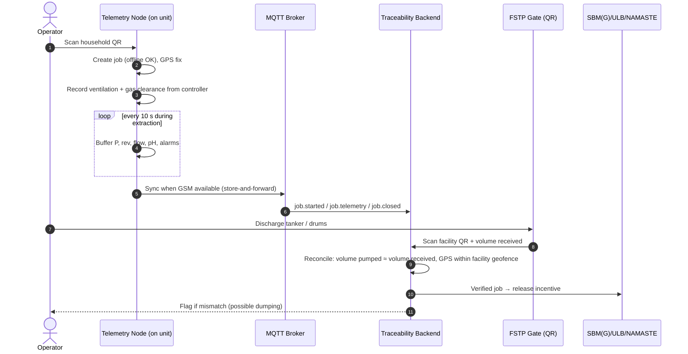
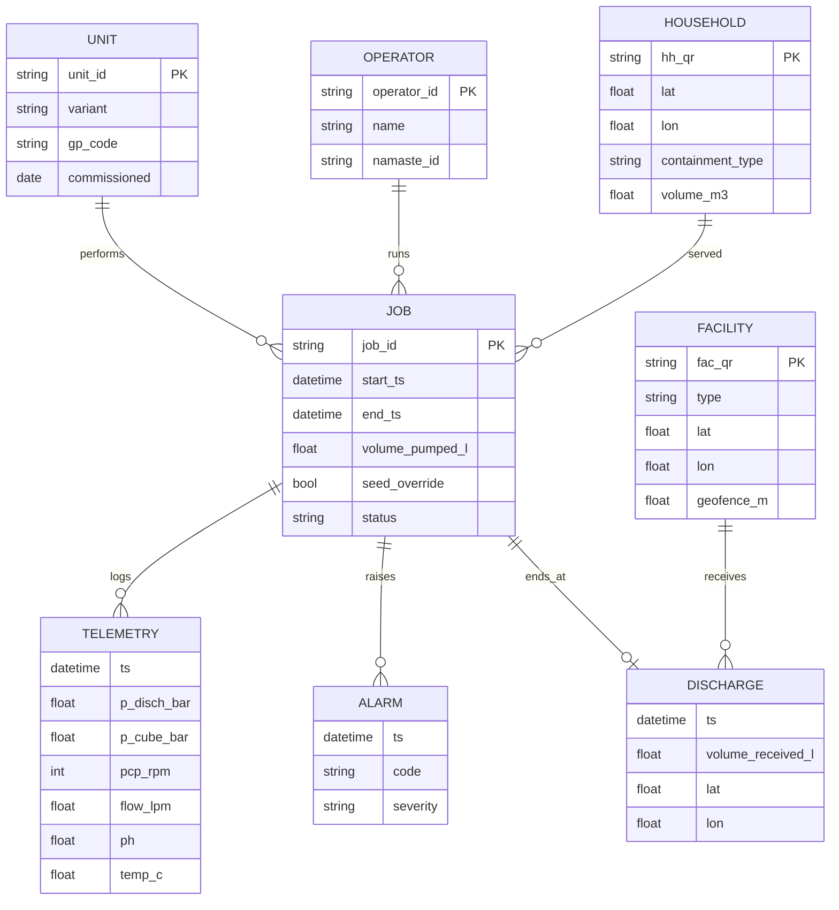

# 07 · Telemetry and Digital Traceability Platform

The goals are to make every desludging job **verifiable**, to make illegal dumping **detectable**, and to make the incentive payout **automatic**.

---

## 1. End-to-end flow



## 2. Telemetry node hardware

| Block | Choice | Notes |
| :--- | :--- | :--- |
| MCU | ESP32-S3, or a shared STM32 with the machine controller | Talks to the controller over UART/CAN. Has **read-only** access to safety states. |
| Cellular | 4G Cat-1 with 2G fallback | Hill coverage is patchy. |
| GNSS | Multi-constellation, including NavIC (IRNSS) | Indian constellation support. |
| Storage | 32 MB SPI flash, ring buffer | Holds ≥ 30 days of jobs (TEL-02). |
| QR | Serial 2D scanner module, or the operator's phone app over BLE | Low cost. |
| Power | From the 12/24 V auxiliary rail, with supercap hold-up for a clean shutdown | — |

## 3. Data model



## 4. Message formats (MQTT, JSON)

Topic structure: `fsm/{state}/{gp}/{unit_id}/{event}`

```jsonc
// fsm/HP/SIR001/U-0042/job.started
{
  "job_id": "U-0042-20261019-03",
  "hh_qr": "HH-SIR001-00871",
  "operator_id": "OP-1189",
  "ts": "2026-10-19T09:41:12+05:30",
  "gps": {"lat": 30.5601, "lon": 77.2954, "acc_m": 6},
  "vent": {"duration_s": 612, "gas_min": {"o2": 20.4}, "gas_max": {"h2s": 3, "ch4_lel": 2, "co": 4}},
  "fw": "1.0.3"
}
```

```jsonc
// fsm/HP/SIR001/U-0042/job.telemetry   (batched, 10 s samples)
{
  "job_id": "U-0042-20261019-03",
  "samples": [
    {"t": 0,  "p_d": 6.2, "p_c": -0.42, "rpm": 290, "q": 141, "aug_a": 6.1, "jet": false},
    {"t": 10, "p_d": 9.8, "p_c": -0.40, "rpm": 290, "q": 138, "aug_a": 8.7, "jet": true}
  ]
}
```

```jsonc
// fsm/HP/SIR001/U-0042/job.closed
{
  "job_id": "U-0042-20261019-03",
  "volume_pumped_l": 1840,
  "seed_override": false,
  "alarms": [{"code": "W_JET_LOW_FLOW", "ts": "…"}],
  "decon_confirmed": true
}
```

## 5. Volume reconciliation and anti-dumping rules

| Rule | Logic | Action |
| :--- | :--- | :--- |
| R1 Geofence | The discharge GPS must be within the facility's `geofence_m` | Fail → flag |
| R2 Volume match | \|V<sub>received</sub> − ΣV<sub>pumped</sub>\| ≤ 15% for jobs since the last discharge | Fail → manual review |
| R3 Time window | Discharge must happen within 24 h of the last job (configurable) | Fail → flag |
| R4 Safety record | The job must contain a valid ventilation and gas record | Missing → job not eligible for incentive |
| R5 Unknown stop | The tanker stops for more than 10 min outside the corridor (optional tanker GPS) | Alert |

## 6. Backend (reference implementation)

| Layer | Tech (suggested) |
| :--- | :--- |
| Broker | Mosquitto / EMQX |
| API | Node.js (Fastify) or Python (FastAPI) |
| DB | PostgreSQL + PostGIS (geofences), TimescaleDB extension for telemetry |
| Dashboard | React + MapLibre: GP map, job list, alarms, volumes |
| Operator app | PWA (offline-first) for QR scan, job status and SOP prompts in local languages |
| Integration | REST/webhook to SBM(G) / ULB portals (subject to their API availability) |

**Shared with the simulation.** The Web3D simulation publishes the **same JSON messages** from a simulated unit, so the dashboard can be demonstrated end-to-end without hardware (see [simulation/02 §6](simulation/02-architecture-and-tech-stack.md#6-integration-with-the-telemetry-platform)).

## 7. Privacy and security

- Household identity is a QR ID only. Names and phone numbers stay in the GP register and are not sent in telemetry.
- Each unit uses TLS over MQTT with a per-device certificate.
- Firmware updates are signed.
- The telemetry node cannot command motors. It is physically read-only toward the safety layer.
