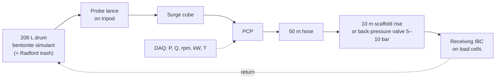

# 08 · Test and Validation Plan (target TRL-6)

All testing uses **non-biological simulants**, so no faecal matter is handled at hackathon stage. Each test traces to requirements in [02](02-requirements-specification.md).

---

## 1. Test rig

Instrumentation:
- Load cells under the receiving IBC, giving the true mass flow
- PT-01/02/03
- PCP tachometer
- Clamp-on power meter on every motor
- Thermocouples
- Camera on the screen (through a clear acrylic drum section)

## 2. Stage 0 — Simulant characterisation

| Test | Method | Output |
| :--- | :--- | :--- |
| T0.1 Simulant recipe | Bentonite + water at 3, 5, 7, 9, 12, 15% w/w. Hydrate 24 h. | Batch log |
| T0.2 Yield stress / viscosity | Rotational rheometer, or a **vane-in-cup method + slump test** if no rheometer is available | τy(TS) and μp(TS) curves, which replace the assumed fits in [04 §3](04-engineering-calculations.md#3-rheology-model) |
| T0.3 Cold behaviour | Repeat T0.2 at 5 °C (ice bath) | Temperature factor for the Ea fit |

## 3. Stage 1 — Rheological performance

| ID | Test | Pass criteria | Req. |
| :--- | :--- | :--- | :--- |
| T1.1 | Thin slurry (3–7%) baseline, vacuum + PCP | ≥ 3.0 L/s at lance (≈ 180 L/min) | SYS-02 |
| T1.2 | Consolidated slurry (9–12%), suction only, no auger or jets | Record the drop (expected < 1.5 L/s) and observe ratholing | — |
| T1.3 | Same as T1.2 + auger | Flow improvement recorded | PRB-03/05 |
| T1.4 | Same as T1.2 + auger + closed-loop jetting | **≥ 2.5 L/s** restored, **zero added water** (drum mass balance) | PRB-06, SYS-05 |
| T1.5 | Air-assist lift: lance 6 m below the cube on the scaffold | Sustained flow; record ρmix through a differential-pressure method | PRB-07 |

## 4. Stage 2 — Trash stress test (modified Radford recipe)

Seed a 208 L drum with:
- 6 toilet rolls (unrolled)
- 21 paper towels
- 12 sanitary napkins
- 23 tampons
- 22 hygiene items
- 8 hair clumps ≥ 250 mm
- 32 small plastic bags
- 11 knotted bags of 50 g simulant

| ID | Test | Pass criteria | Req. |
| :--- | :--- | :--- | :--- |
| T2.1 | Lance at 300 rpm in the trash drum | **60 min** clog-free, no manual cleaning | PRB-03/04 |
| T2.2 | Trash ingress count | Count items passing the screen. Target: none larger than 20 mm reach the PCP. | BST-03 |
| T2.3 | Auger reversal | Reversal clears any wrap within 10 s | PRB-03 |

## 5. Stage 3 — Hydraulic performance vs head

| ID | Test | Pass criteria | Req. |
| :--- | :--- | :--- | :--- |
| T3.1 | PCP curve: Q vs ΔP at 200/300/400 rpm, water then 9% slurry | Map the envelope and compare with [04 §5](04-engineering-calculations.md#5-pcp-booster-sizing-and-operating-envelope) | BST-04 |
| T3.2 | Hose friction: ΔP over 50 m at 3 flows for 3 TS levels | Within ±25% of the Buckingham–Reiner prediction. If it is outside, recalibrate the simulation. | — |
| T3.3 | Simulated rise: back-pressure 5, 8, 10 bar | Continuous **150–300 L/min** (Option B) or ≥ 90 L/min at 12 bar (Option A) | BST-04 |
| T3.4 | Relief: close the discharge valve | Relief opens at 20 ± 1 bar; PT-02 trip at 22 bar | BST-06 |
| T3.5 | Dry-run: stop the inflow | PCP power cut ≤ 1.5 s | BST-05 |
| T3.6 | Volume metering | Revolution-counted volume vs load cell, error ≤ 5% | BST-07 |
| T3.7 | Specific energy | < 1.5 kWh/m³ over a full 200 L batch | SC-4 |

## 6. Stage 4 — Safety interlock verification (fault injection)

Use a **calibration gas kit** (bump-test bottles) or the detector's built-in test mode. Never generate real H₂S.

| ID | Injected condition | Expected | Req. |
| :--- | :--- | :--- | :--- |
| T4.1 | Start pressed before 10 min | Motors stay locked; the pendant shows the remaining time | SAF-02 |
| T4.2 | H₂S 25 ppm bump gas at minute 7 | Timer resets, alarm sounds | SAF-03 |
| T4.3 | H₂S bump gas during extraction | All motors stop ≤ 2 s, blower stays on | SAF-04 |
| T4.4 | MCU halted (debugger) | Watchdog drops K1 ≤ 250 ms | SAF-05 |
| T4.5 | E-stop on pendant and skid | Immediate stop | SAF-06 |
| T4.6 | Outrigger up | PCP cannot start / stops | SAF-07 |
| T4.7 | Tilt the chassis on a ramp > 25° | Alarm; PCP inhibited | MOB-05 |
| T4.8 | Close out without decon confirmation | Job cannot be closed | SAF-10 |

## 7. Stage 5 — Mobility (crawler / handcart)

| ID | Test | Pass criteria | Req. |
| :--- | :--- | :--- | :--- |
| T5.1 | Concrete ramp at 35°, loaded | Climbs and descends with no slip at full payload | MOB-02 |
| T5.2 | Staircase (17 cm rise / 28 cm tread, ≈ 31°) | Traverses safely | MOB-02 |
| T5.3 | 0.9 m wide lane with a 90° turn | Passes without contact | MOB-01 |
| T5.4 | Handcart behind a 2-wheeler | Stable at 20 km/h; braking OK | MOB-06 |

## 8. Stage 6 — Climate

| ID | Test | Pass criteria |
| :--- | :--- | :--- |
| T6.1 | Cold soak in a cold room / reefer container at −10 °C for 8 h, then start | Heater brings the stator above 5 °C in ≤ 20 min, then normal operation |
| T6.2 | Purge test | After blow-purge, < 0.5 L residual in the lines (weighed) |
| T6.3 | Rain / IP test | Hose-down per IP65 on enclosures, no ingress |

## 9. Simulation validation (sim ↔ rig)

| ID | Check | Tolerance |
| :--- | :--- | :--- |
| TS-1 | The simulation reproduces every number in [04](04-engineering-calculations.md) tables (unit tests) | ±1% (same equations) |
| TS-2 | The simulation, re-calibrated with the Stage 0 rheology, predicts T3.2 friction | ±15% |
| TS-3 | The simulation's PCP curve matches T3.1 | ±10% |
| TS-4 | The interlock state machine in the simulation passes all T4.x cases | Exact |

## 10. Deliverables

- Test reports (template: `test-reports/TEMPLATE.md`, to be created)
- Raw DAQ CSVs in `test-data/`
- Videos of T1.4, T2.1, T3.3 and T4.3 for the SIH presentation
