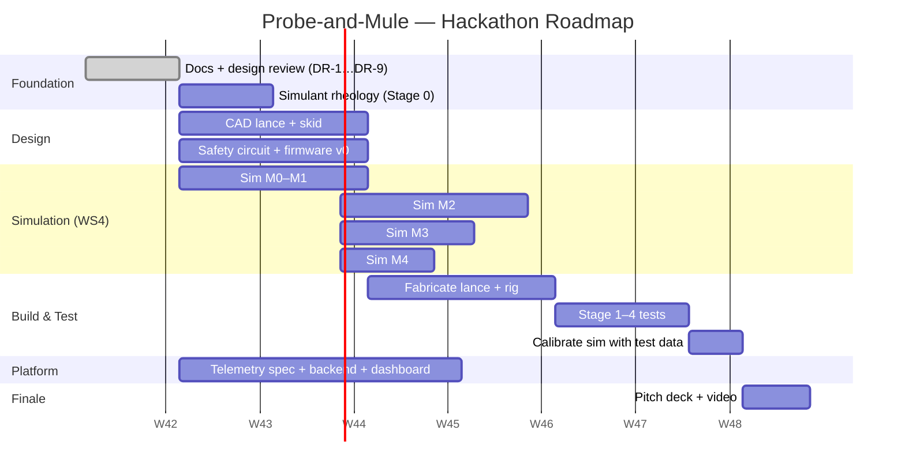

# 09 · Project Plan, Team and Repository Roadmap

## 1. Workstreams

| WS | Workstream | Output | Lead (role) |
| :--- | :--- | :--- | :--- |
| WS1 | Mechanical design | CAD of lance, skid, frame; drawings; fabrication | Mechanical lead |
| WS2 | Electrical and controls | Safety circuit, MCU firmware, sensor integration | Electronics / embedded lead |
| WS3 | Testing | Simulant rig, Stage 0–6 tests, reports | Test lead |
| WS4 | **Web3D simulation** | Browser digital twin: sandbox, training, demo | Simulation / 3D lead + frontend dev |
| WS5 | Digital platform | Telemetry message spec, backend, dashboard, PWA | Backend / full-stack dev |
| WS6 | Documentation and pitch | Docs (this folder), PPT, video, cost and impact case | Team lead / presenter |

A typical SIH team has 6 members. The suggested split is one lead per WS1–WS5, with the team lead owning WS6 and integration.

## 2. Phased timeline

The plan uses relative weeks. Align it with the official SIH schedule once the round dates are confirmed.



## 3. Milestones and exit criteria

| MS | Name | Exit criteria |
| :--- | :--- | :--- |
| MS1 | Design frozen | All High-severity DR items closed; BoM quotes in hand |
| MS2 | Sim alpha | Physics core passes the TS-1 unit tests; one scene playable |
| MS3 | Rig working | T1.1 and T3.1 done |
| MS4 | Sim beta | All 4 zone scenarios and training mode work; telemetry JSON matches [07](07-telemetry-and-digital-platform.md) |
| MS5 | Validation | Stage 1–4 pass criteria met; simulation calibrated (TS-2/3) |
| MS6 | Finale-ready | Pitch, video, live sim demo, prototype on the stand |

## 4. Repository structure (target)

```
SIH_project_slug/
├── README.md                     ← project overview + doc index
├── information.md / .txt         ← original research report (source)
├── docs/
│   ├── 01 … 09 *.md              ← engineering documents
│   └── simulation/               ← Web3D simulation design docs
├── sim/                          ← Web3D simulation source (Vite + TS)
├── firmware/                     ← controller + telemetry firmware
├── platform/                     ← backend, dashboard, operator PWA
├── cad/                          ← STEP / native CAD, drawings (PDF)
├── test-data/                    ← raw DAQ CSVs
└── test-reports/                 ← completed test reports
```

## 5. Working agreements

- **Branches:** `main` is protected. Use feature branches named `docs/…`, `sim/…`, `fw/…` and `platform/…`, and merge through PRs with 1 review.
- **Issues:** each DR item in [04 §7](04-engineering-calculations.md#7-design-consistency-review) becomes a GitHub Issue with the label `design-review`.
- **Single source of parameters:** engineering parameters live in `sim/src/data/parameters.json`, mirrored in [04 §8](04-engineering-calculations.md#8-parameter-table-shared-with-the-simulation). Change both together.
- **Units:** SI internally (Pa, m, s, kg, m³/s). Display in bar, L/min and mm.

## 6. Risks (project)

| Risk | Impact | Mitigation |
| :--- | :--- | :--- |
| PCP lead time from the OEM | Delays the rig | Order in week 1; rent or borrow a demo pump |
| No rheometer access | Unvalidated physics | Use the vane-in-cup / slump method; borrow a college civil-engineering lab |
| Crawler chassis cost and lead time | Prototype late | Demonstrate on the handcart; show the crawler in simulation and as a scale model |
| Simulation scope creep | Not demo-ready | Lock the MVP in [simulation/07](simulation/07-implementation-plan-and-testing.md); polish only after MS4 |
| Unverified statistics in the pitch | Credibility | Fact-check DR-9 against official sources |
