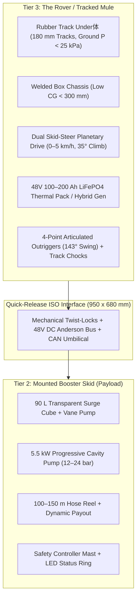
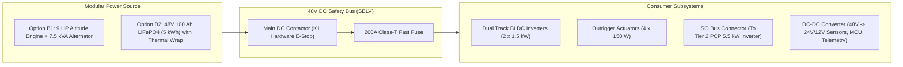
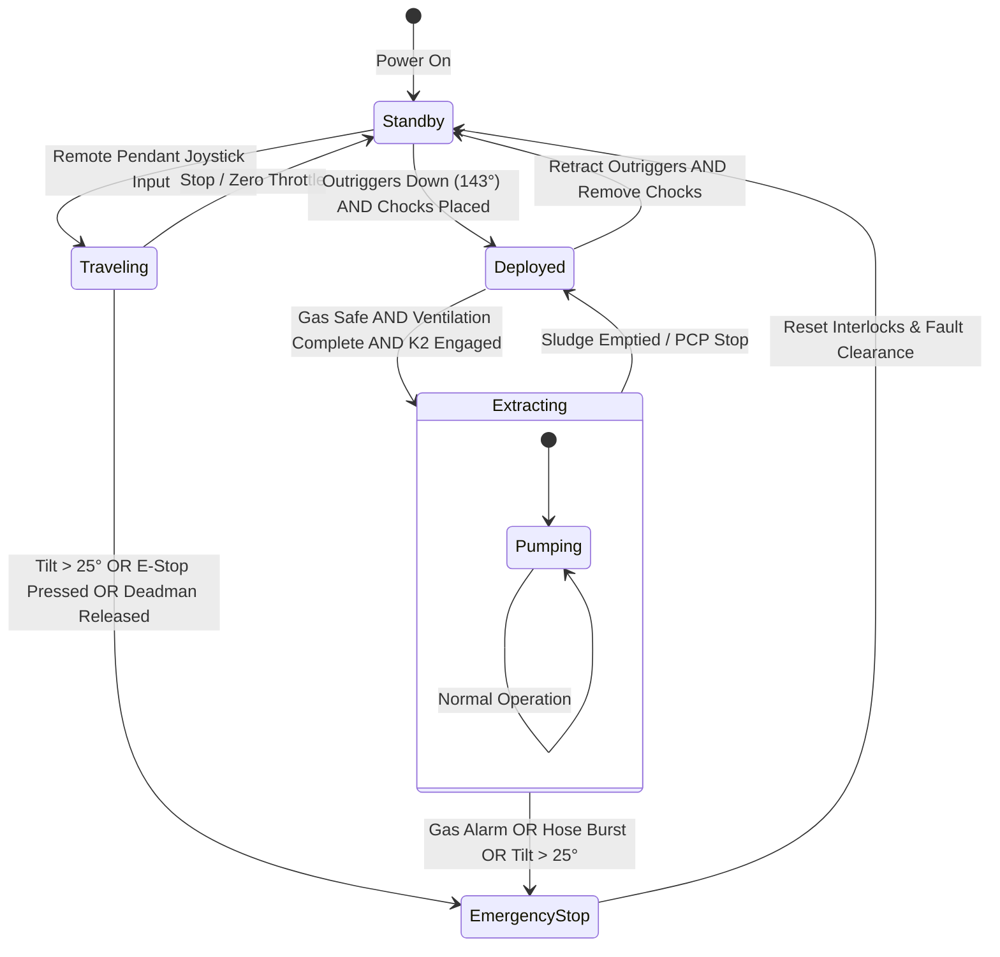

# 10 · Rover and Mobility Architecture (Tier 3 · The Mule)

> **Document ID:** DOC-10-ROVER  
> **Target Subsystem:** Tier 3 All-Terrain Tracked Mobility Carrier ("The Mule" / "The Rover")  
> **System Context:** Probe-and-Mule Mechanized Desludging System (SIH Problem Statement 26258)  
> **Status:** Approved Engineering Baseline

---

## 1. Executive Summary and Operational Context

In hilly Himalayan topography (e.g., Himachal Pradesh, Uttarakhand, Nagaland) and dense informal settlements, on-site sanitation containments (septic tanks, single and twin leach pits) are situated along narrow, stepped footpaths with grades exceeding $35^\circ$ ($70\%$) and vertical elevation drops of $20\text{–}50\text{ m}$ below the nearest motorable road. Standard vacuum tankers ("honey suckers") cannot traverse these lanes due to vehicular width constraints ($> 2.5\text{ m}$), weight ($> 8\text{ tonnes}$), and atmospheric suction lift limitations ($< 4\text{ m}$ barometric limit at $2,200\text{ m}$ altitude).

The **Tier 3 Rover** (internally designated **"The Mule"**, Variant B Tracked Crawler) is the robotic carrier platform engineered to solve this last-mile access deficit. It navigates flights of stairs and mud terraces to deliver the **Tier 2 High-Pressure Booster Skid** directly to the household pit mouth, operating under full hardware interlock and remote tethered control.



---

## 2. Technical Specifications Matrix

| Parameter | Specification | Compliance / Standard | Engineering Rationale |
| :--- | :--- | :--- | :--- |
| **Max Overall Width** | $750\text{ mm}$ | **MOB-01** | Clears $800\text{ mm}$ hill doorways and peri-urban alleyways. |
| **Overall Length** | $1,800\text{ mm}$ ($1.8\text{ m}$) | System Layout §7 | Spans 3 typical stair treads ($3 \times 300\text{ mm}$) to prevent tipping. |
| **Chassis Deck Height** | $405\text{ mm}$ | Stability Criterion | Keeps loaded centre of gravity below $380\text{ mm}$. |
| **Gradeability** | $35^\circ$ ($70\%$ slope) | **MOB-02** | Handles Himalayan public stair flights ($30\text{–}35^\circ$). |
| **Maximum Payload** | $500\text{ kg}$ | **MOB-03** | Carries Tier 2 Booster Skid ($275\text{ kg}$) + hoses + tools. |
| **Unladen Mass** | $\approx 185\text{ kg}$ | Mass Budget §7 | High power-to-weight ratio for uphill return climbs. |
| **Ground Pressure** | $21.4\text{ kPa}$ (at $500\text{ kg}$ payload) | **MOB-06** | Prevents sinkage in flood-plain mud and soft soils ($< 25\text{ kPa}$). |
| **Travel Speed** | $0\text{–}5\text{ km/h}$ (variable) | **MOB-03** | Controlled inching on stairs ($0.2\text{–}0.5\text{ m/s}$); transport on road ($1.4\text{ m/s}$). |
| **Ground Clearance** | $120\text{ mm}$ | Obstacle Clearance | Crosses stair lips, surface roots, and cobblestone gutters. |
| **Electrical Architecture** | $48\text{ V DC}$ Nominal | **SAF-06** / SELV | Safe extra-low voltage prevents electrocution in wet mud. |
| **Environmental Rating**| IP67 Subsystems | **ENV-02** | Submersible track drives; immune to water/mud splash and snow. |
| **Operating Temperature**| $-20^\circ\text{C to }+50^\circ\text{C}$ | **ENV-01** | Sub-zero Himalayan winter to Western Rajasthan summer. |

---

## 3. Mechanical & Subsystem Architecture

### 3.1 Rubber Track Drive Assembly (Underbody)
The rover utilizes dual continuous reinforced rubber tracks engineered for high traction on wet rock, snow, and concrete stairs:
- **Track Width:** $180\text{ mm}$ per track.
- **Contact Length:** $1,420\text{ mm}$ on horizontal ground ($1.42\text{ m}$).
- **Total Ground Contact Area:** 
  $$A_{\text{contact}} = 2 \times 0.18\text{ m} \times 1.42\text{ m} \approx 0.5112\text{ m}^2$$
- **Ground Pressure Calculation (Fully Loaded $460\text{ kg}$ Gross Mass):**
  $$P_{\text{ground}} = \frac{M_{\text{total}} \cdot g}{A_{\text{contact}}} = \frac{460\text{ kg} \times 9.81\text{ m/s}^2}{0.5112\text{ m}^2} \approx 8.83\text{ kPa} \quad (\text{unladen})$$
  $$P_{\text{ground, max}} = \frac{(185\text{ kg} + 500\text{ kg}) \times 9.81}{0.5112\text{ m}^2} \approx 13.15\text{ kPa} \ll 25\text{ kPa}$$
- **Wheel Geometry:**
  - Front Drive Sprocket: $\varnothing 320\text{ mm}$ steel-reinforced polyurethane tooth engagement.
  - Rear Idler Wheel: $\varnothing 320\text{ mm}$ with integrated screw tensioner.
  - Road Wheels: $5$ dual-flanged steel roller pairs per side ($\varnothing 140\text{ mm}$ outer, $\varnothing 220\text{ mm}$ ends) distributing load uniformly across stair nosings.

```
       Front Idler                                                Rear Sprocket
       ╭─────────╮   Road Rollers (5 pairs)                       ╭─────────╮
      │     ●     │───○───────○───────○───────○───────○──────────│     ●     │
       ╰─────────╯                                                ╰─────────╯
      ▒▒▒▒▒▒▒▒▒▒▒▒▒▒▒▒▒▒▒▒▒▒▒▒▒▒▒▒▒▒▒▒▒▒▒▒▒▒▒▒▒▒▒▒▒▒▒▒▒▒▒▒▒▒▒▒▒▒▒▒▒▒▒▒▒▒▒▒▒▒▒▒▒
                     180 mm Continuous Chevron Rubber Track
```

### 3.2 Chassis Frame and Payload Interface
- **Structural Frame:** Rectangular hollow section (RHS) $60 \times 40 \times 3\text{ mm}$ structural mild steel (IS 2062 Gr. B), robotic MIG welded and zinc-phosphated with electrostatic epoxy powder coating ($120\ \mu\text{m}$).
- **Yellow Working Deck:** $750 \times 1,820 \times 50\text{ mm}$ non-slip diamond checker-plate aluminum deck providing structural support and toe rails.
- **ISO Quick-Release System:** 4-point quarter-turn twist-locks ($950\text{ mm}$ longitudinal $\times 680\text{ mm}$ lateral spacing). Allows the Tier 2 Booster Skid to be dismounted in $< 60\text{ seconds}$ by two operators using folding carry handles.

### 3.3 Articulated Outriggers and Wheel Chocks
High-pressure sludge pumping produces dynamic reaction forces and variable fluid mass distributions that could cause vehicle tilting or runaway on $35^\circ$ slopes.
- **Outrigger Assemblies:** 4 pivoting outriggers mounted at the extreme corners of the chassis ($x = \pm 380\text{ mm}, z = \pm 720\text{ mm}$).
- **Deployment Kinematics:** When stowed, outrigger legs point vertically upward ($0^\circ$). At the work site, electric/hydraulic actuators swing the legs through an angle of $143^\circ$ downward and outward until the $\varnothing 140\text{ mm}$ articulating rubber-cushioned ground pads make firm contact with the terrain.
- **Track Chocks:** Twin high-visibility safety polyurethane chocks deployed immediately behind the downhill tracks ($z = -0.92\text{ m}$).
- **Limit Sensing:** Dual inductive proximity switches (IP68) detect full outrigger extension and chock placement, providing a hardware interlock signal to the main control unit (MCU).

---

## 4. Powertrain and Electrical Architecture

### 4.1 Drive-Train Transmission
- **Configuration:** Independent dual-motor skid-steer differential drive.
- **Motors:** Twin $48\text{ V}$, $1.5\text{ kW}$ continuous ($3.0\text{ kW}$ peak) Brushless DC (BLDC) motors with internal Hall-effect encoders.
- **Gearboxes:** In-line planetary reduction gearboxes with a gear ratio of $i = 30:1$, delivering up to $360\text{ Nm}$ combined tractive torque at the drive sprockets.
- **Dynamic Inching & Braking:** Closed-loop field-oriented control (FOC) allows precision millimeter positioning on steps. Redundant spring-applied, electrically released (fail-safe) dynamic disc brakes lock the tracks instantly on zero throttle or E-stop actuation.

### 4.2 Power Distribution Architecture
The vehicle features a centralized $48\text{ V DC}$ bus powered by either of two interchangeable energy modules:



- **Himalayan Thermal Conditioning:** The battery compartment includes an aerogel insulation jacket ($15\text{ mm}$) and an internal $120\text{ W}$ PTC heating mat. When ambient temperature drops below $0^\circ\text{C}$, the BMS redirects auxiliary charging current to preheat the cells to $+10^\circ\text{C}$ before high-current discharge is allowed, preventing lithium plating.

---

## 5. Control, Safety & Interlock Integration

The rover is strictly a carrier. To guarantee operator safety and eliminate single-point operational failures, the rover hardware is governed by a **Category 3 / Performance Level d (PL d)** safety interlock architecture.



### 5.1 Interlock Truth Table (Rover Constraints)

| Condition | Track Travel | Outriggers | PCP Booster | Vane Pump | Alarm / Indicator |
| :--- | :---: | :---: | :---: | :---: | :--- |
| **Normal Driving (Lane)** | ✅ Allowed | 🔒 Locked Stowed | ❌ Inactive | ❌ Inactive | LED Ring Solid Amber |
| **Arrived at Pit Mouth** | ❌ Disabled | ✅ Extending (0–143°) | ❌ Inactive | ❌ Inactive | Amber Flashing |
| **Outriggers Down + Chocks Placed** | ❌ Disabled | ✅ Locked Grounded | ⚠️ Priming | ✅ Allowed | Green Ring Ready ($K_1$) |
| **Desludging Extraction Active** | ❌ Interlocked | 🔒 Locked Grounded | ✅ Active | ✅ Active | Green Solid Ring ($K_2$) |
| **Vehicle Tilt $\ge 25^\circ$** | ❌ Cutoff | 🔒 Locked | ❌ Tripped | ❌ Tripped | Audio Siren + Red Flash |
| **PCP Pump Running ($\text{RPM} > 1$)** | ❌ **HARD LOCK** | 🔒 Locked | ✅ Running | ✅ Running | Drive joystick ignored |

---

## 6. Software & 3D Digital Twin Architecture

In the Web3D simulation platform ([`sim/src/scene/`](../sim/src/scene/)), the rover is [`Crawler.tsx`](../sim/src/scene/Crawler.tsx), which poses the machine on the lane and composes the sub-assemblies in [`sim/src/scene/crawler/`](../sim/src/scene/crawler/). The carrier vehicle (tracks, chassis, battery bay) is decoupled from the pumping process module (the Tier 2 booster skid), and every dimension, hose attach point and label anchor comes from one general-arrangement file, [`layout.ts`](../sim/src/scene/crawler/layout.ts).

### 6.1 Component Hierarchy

```
Scene.tsx
  └── <Crawler>                       [Crawler.tsx: lane pose, yaw smoothing, track odometers, reel payout; deck]
        ├── <Undercarriage />         [Rubber tracks, sprockets, idlers, rollers, chassis tub, battery bay, lamps]
        ├── <Booster />               [ISO skid: PCP train, discharge piping, surge cube + vane pump, controller]
        └── <Superstructure />        [Hose reel, roof frame + stowage, beacon, LED ring, outriggers, rear deck]
```

### 6.2 Spline Sampling and Kinematics Engine
The physical simulation executes in a 100 Hz Web Worker ([`sim/src/core/models/vehicle.ts`](../sim/src/core/models/vehicle.ts)), while the render loop ([`sim/src/scene/Crawler.tsx`](../sim/src/scene/Crawler.tsx)) samples the lane spline arc-length:

```typescript
export function crawlerPose(s_m: number, heading: 1 | -1, pitchDeg: number, rollDeg: number) {
  const a = E1_LANE.sample(Math.max(0, s_m));
  const t = a.t;
  const h = Math.hypot(t.x, t.z) || 1;
  let yaw = Math.atan2(t.x / h, t.z / h);
  if (heading < 0) yaw += Math.PI;
  const pitchWorld = ((heading > 0 ? -pitchDeg : pitchDeg) * Math.PI) / 180;
  return { 
    pos: new THREE.Vector3(a.p.x, a.p.y, a.p.z), 
    yaw, 
    pitch: pitchWorld, 
    roll: (rollDeg * Math.PI) / 180 
  };
}
```

### 6.3 Skid-Steer Yaw Smoothing
To realistically emulate differential track steering through sharp $90^\circ$ alleyway turns without visual snapping, an angular low-pass filter unwraps the shortest path across the $\pm\pi$ boundary:

```typescript
let dy = pose.yaw - sm.yaw;
while (dy > Math.PI) dy -= Math.PI * 2;
while (dy < -Math.PI) dy += Math.PI * 2;
sm.yaw += dy * Math.min(1, dt * 4);
root.current.rotation.set(0, sm.yaw, 0);
body.current.rotation.set(pose.pitch, 0, pose.roll);
```

### 6.4 Track Odometers and Running Gear
Each belt carries its own odometer: forward travel along the lane plus the pivot term, so the two tracks counter-rotate through the landing turns. The chevron lugs ride a belt path built round the sprocket and idler circles, and every wheel turns with its belt:

```typescript
const ds = Math.abs(v.s_m - sm.s);          // forward travel this frame
mo.odo[0] += ds + dYaw * TRACK.x;           // −x belt
mo.odo[1] += ds - dYaw * TRACK.x;           // +x belt (slows in a turn towards +x)
sprocket.rotation.x = odo / TRACK.sprocket.r; // idler and rollers likewise
```

---

## 7. FMEA (Failure Mode and Effects Analysis) for Rover Mobility

| Failure Mode | Root Cause | Effect on System | Severity (1–10) | Occurrence (1–10) | Detection (1–10) | RPN | Mitigation Strategy |
| :--- | :--- | :--- | :---: | :---: | :---: | :---: | :--- |
| **Track Slippage on Icy Stairs** | Low friction coefficient on frost/ice ($\mu < 0.2$). | Vehicle slides downhill; potential cable/hose snag. | 8 | 4 | 2 | **64** | Deep chevron rubber tread with hardened carbide ice studs; mechanical track chocks. |
| **Rollover on Uneven Terraces** | Operator navigating cross-slope $> 25^\circ$. | Equipment rollover, chassis damage, battery hazard. | 9 | 2 | 3 | **54** | Dual-axis MEMS inclinometer alarm at $25^\circ$; automatic traction kill at $30^\circ$; low CG ($< 300\text{ mm}$). |
| **Track Thrown / De-Tracking** | Lateral rock wedge between idler and track. | Complete immobilization in narrow alley. | 7 | 3 | 2 | **42** | Dual-flanged road rollers with integrated mud scraper bars and dynamic spring tensioner. |
| **Sub-Zero Battery Freezing** | Overnight storage at $-15^\circ\text{C}$ in winter. | Severe voltage drop; BMS locks discharge. | 7 | 3 | 2 | **42** | Automatic PTC silicone heating pad powered by GP grid during charging; aerogel thermal blanket. |
| **Drive Shaft Brake Failure** | Power loss on steep $35^\circ$ stair flight. | Uncontrolled gravity rollback down stairs. | 9 | 1 | 2 | **18** | Spring-applied fail-safe electromagnetic holding brakes automatically engage on zero power. |

---

## 8. Summary of Decoupling Benefits

By splitting the rover into the carrier ([`Undercarriage.tsx`](../sim/src/scene/crawler/Undercarriage.tsx)) and the booster skid ([`Booster.tsx`](../sim/src/scene/crawler/Booster.tsx)), with the general arrangement in [`layout.ts`](../sim/src/scene/crawler/layout.ts):
1. **Model Decoupling:** The carrier vehicle can be inspected, benchmarked, or swapped independently of the treatment module.
2. **Alternative Payloads:** The same rover can mount a 200 L slurry shuttle tank, an emergency generator pack, or a cable-hoist winch without altering chassis kinematics.
3. **Simulation Modularity:** Pose, kinematics and track rendering live in [`Crawler.tsx`](../sim/src/scene/Crawler.tsx) and `Undercarriage.tsx`, the pump internals and their X-ray views in `Booster.tsx`, and the reel, roof frame and outriggers in [`Superstructure.tsx`](../sim/src/scene/crawler/Superstructure.tsx). Hoses and labels read their attach points from `layout.ts`, so moving a component never leaves a hose floating.
