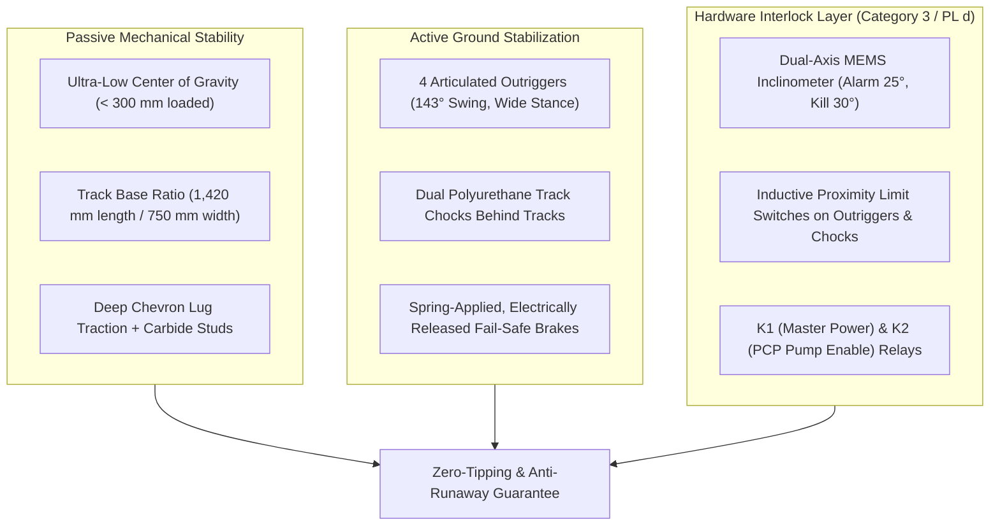

# Probe-and-Mule: Technical Answers & Implementation Status

> **Document ID:** DOC-11-QA  
> **Project:** Probe-and-Mule Mechanized Faecal Sludge Extraction System  
> **Target Problem Statement:** Smart India Hackathon, PS 26258 (Ministry of Jal Shakti, SBM-Grameen)  
> **Status:** Official Technical Response & System Status  

---

## 1. How will the machine actually extract thick sludge?

### 1.1 The Physical Problem: The Rheological Barrier
Faecal sludge in un-emptied pits, septic tanks, and single/twin leach pits undergoes long-term anaerobic digestion and gravitational settling. At the bottom layers (consolidated sludge cake), Total Solids (TS) reach **15% to 25%**, exhibiting non-Newtonian **Bingham-plastic** and **Herschel–Bulkley** shear-thinning rheological behavior:

$$\tau = \tau_y(TS) + \mu_p(TS)\,\dot{\gamma}$$

From the project's empirical fits:
- At $\text{TS} \approx 22\%$, yield stress $\tau_y \approx 273\text{ Pa}$ and plastic viscosity $\mu_p \approx 1.0\text{ Pa}\cdot\text{s}$.
- At cold Himalayan temperatures ($2^\circ\text{C}$ vs $25^\circ\text{C}$), viscosity increases by an additional **$1.9\times$** (Arrhenius temperature activation energy $E_a \approx 20\text{ kJ/mol}$).

Conventional vacuum tankers ("honey-suckers") fail completely because:
1. **Barometric Lift Cutoff**: Atmospheric pressure at $2,200\text{ m}$ elevation drops to $77.5\text{ kPa}$. The theoretical maximum suction lift for dense sludge ($\rho = 1,100\text{ kg/m}^3$) is under $6.1\text{ m}$. After line friction, real suction lift is **$< 4\text{ m}$**.
2. **Yield Stress Immobilization**: At $\tau_y \approx 273\text{ Pa}$, the cake acts like a solid gel; static suction simply creates a narrow hole through liquid supernatant ("ratholing"), leaving the solid cake untouched.
3. **Pumping Pressure Bottleneck**: Pushing unconditioned $273\text{ Pa}$ cake across $150\text{–}200\text{ m}$ of hose would require $> 40\text{–}50\text{ bar}$ of friction pressure, far exceeding standard flexible hose burst ratings and requiring an unaffordable $> 20\text{ kW}$ pump.

---

### 1.2 The Extraction Mechanism (Tier 1 Probe Lance)
To eliminate manual human entry (strictly complying with PEMSR Act 2013), the machine uses the **Tier 1 Probe**—a $1.5\text{ m}$, $\varnothing 76.2\text{ mm}$ (3-inch OD) stainless steel (SS316) in-pit lance suspended from a foldable davit tripod and operated by an IP67 remote pendant:

```mermaid
flowchart TD
    subgraph PitBed["Pit Bottom (Stratified Cake, TS 15–25%)"]
        Cake["Consolidated Cake (τy ≈ 273 Pa)"]
        Trash["Debris / Rags / Plastics"]
    end

    subgraph Tier1["Tier 1 Probe Lance Assembly"]
        Auger["External Helical Auger (300 RPM, τ ≥ 300 Pa)"]
        Wipers["Continuous Internal Wiping Blades"]
        Screen["Laser-Cut Perforated Screen (12.7 mm holes)"]
        Jets["Dual Tangential Jetting Nozzles (4–6 bar)"]
        Sparger["Compressed Air Sparger Ring (2–3 bar, 150 L/min)"]
    end

    Cake -->|Mechanical Shear| Auger
    Auger -->|Breaks Yield Stress| Screen
    Trash -->|Excluded & Shed| Screen
    Wipers -->|Prevents Blinding| Screen
    Jets -.->|Recirculated Supernatant| Cake
    Screen -->|Conditioned Slurry (TS ≤ 12%)| Riser["Suction Riser (2–5 m)"]
    Sparger -.->|Micro-bubbles (ρ ≤ 750 kg/m³)| Riser
    Riser --> Cube["90 L Vacuum Surge Cube (Skid)"]
```

1. **Mechanical Shear via 300 RPM Auger**:
   A solid EN24 alloy drive shaft drives an external helical auger powered by an IP68-sealed 1.2 kW BLDC motor. The auger delivers mechanical shear stress $\tau \ge 300\text{ Pa}$, instantly exceeding the cake yield stress ($\tau_y = 273\text{ Pa}$) and converting the dilatant solid into a fluid stream without human entry.
2. **In-situ Conditioning via Closed-Loop Jetting (Zero Fresh Water)**:
   Two high-velocity tangential nozzles located at the probe tip blast fluid at $4\text{–}6\text{ bar}$. Crucially, the system uses **closed-loop recirculation of the pit's own supernatant liquid** (tapped from the booster skid via a 3-way motorized valve). It dilutes the bottom cake to $\text{TS} \le 12\%$ ($\tau_y \le 53\text{ Pa}$, $\mu_p \le 0.17\text{ Pa}\cdot\text{s}$), bringing discharge hose friction down to a manageable $\approx 8\text{–}10\text{ bar}$. It requires **zero external fresh water**, solving water scarcity in drought-prone and freezing mountain villages.
3. **Continuous Trash Screening & Dynamic Wiping**:
   Faecal pits frequently contain menstrual hygiene products, rags, stones, and plastic bags. The probe intake features a $250\text{ mm}$ long SS316 screen with $12.7\text{ mm}$ (½-inch) laser-cut perforations. Internal wiping blades driven synchronously by the auger continuously shave the screen surface, shedding debris back into the pit and preventing intake blinding.
4. **Air-Assist Lift Sparging**:
   For deep pits ($> 3\text{ m}$) or high altitude ($> 2,000\text{ m}$), an air sparger injects micro-bubbles ($2\text{–}3\text{ bar}$, $150\text{ L/min}$) at the suction collar. This aerates the upward sludge column, reducing its bulk density from $1,100\text{ kg/m}^3$ to $\le 750\text{ kg/m}^3$ via drift-flux multi-phase flow, comfortably pulling the slurry up into the surge cube.
5. **Biological Seed Preservation**:
   Per CPHEEO and SBM(G) guidelines, an active anaerobic septic pit must retain a bottom layer of active microorganisms. The probe features a mechanical $25\text{ mm}$ spacer foot and a hydrostatic pressure depth transducer. At $95\%$ sludge clearance, the controller triggers a "Seed-Layer Stop" alarm, requiring a deliberate supervisor key override to extract further.

---

## 2. How will it reach pits in steep or narrow locations?

### 2.1 The Himalayan Accessibility Barrier
In mountain settlements (e.g., Himachal Pradesh, Uttarakhand, Nagaland) and dense informal urban clusters:
- Pathways are often narrow stepped pedestrian trails ($700\text{–}900\text{ mm}$ wide) cut into hillsides.
- Grades frequently exceed **$30^\circ\text{–}35^\circ$ ($60\text{–}70\%$ slope)** with high stone step risers.
- Houses sit on terraced drops **$20\text{ to }50\text{ m}$ vertically below** the nearest motorable road.
- Standard 8-to-12 tonne vacuum tankers cannot enter lanes narrower than $2.5\text{ m}$, cannot traverse steps, and have hose lengths limited to $25\text{–}30\text{ m}$.

---

### 2.2 The Tier 3 "Mule" Rover Architecture
The **Tier 3 Mule** (Variant B Tracked Crawler) is an ultra-compact robotic transport chassis engineered specifically for steep Himalayan stairs and narrow paths:

```
◄───────────────── 1,800 mm Total Length ─────────────────►
┌────────────────────────────────────────────────────────┐ ▲
│  ISO Quick-Release Platform (Tier 2 Booster Skid Deck) │ │ 405 mm
├────────────────────────────────────────────────────────┤ │ Deck Height
│ [Dual 1.5 kW BLDC]  [48V LiFePO4 / Engine]  [FOC Drive]│ ▼
└─────────┬────────────────────────────────────┬─────────┘
  Front   │  ○○○○○ 5 Dual-Flanged Road Rollers │   Rear
  Idler   └────────────────────────────────────┘  Sprocket
 ╭─────╮   ════════════════════════════════════   ╭─────╮
 │  ●  │───○───────○───────○───────○───────○──────│  ●  │
 ╰─────╯                                          ╰─────╯
 ▒▒▒▒▒▒▒▒▒▒▒▒▒▒▒▒▒▒▒▒▒▒▒▒▒▒▒▒▒▒▒▒▒▒▒▒▒▒▒▒▒▒▒▒▒▒▒▒▒▒▒▒▒▒▒▒
        180 mm Continuous High-Grip Chevron Rubber Tracks
```

1. **Ultra-Narrow $750\text{ mm}$ Envelope (MOB-01)**:
   The crawler has a maximum overall width of $750\text{ mm}$. It passes effortlessly through standard $800\text{ mm}$ village doorways, wicket gates, and stepped alleyways.
2. **Continuous Chevron Rubber Track Assembly**:
   - **Track Width**: $180\text{ mm}$ per track.
   - **Ground Contact Length**: $1,420\text{ mm}$ ($1.42\text{ m}$).
   - **Stair Climbing Geometry**: Spans across **$\ge 3$ consecutive standard stair treads** ($3 \times 300\text{ mm} = 900\text{ mm}$), bridging step edges smoothly and eliminating chassis pitching or track-drop.
   - **Ground Pressure**: Only **$13.15\text{ kPa}$ fully loaded** ($460\text{ kg}$ total vehicle mass), far below the $25\text{ kPa}$ sinkage limit for soft mud, snow, and gravel paths.
   - **Carbide Ice Studding**: The track lugs accept threaded tungsten carbide studs for frost, ice, and wet moss on mountain steps.
3. **High-Torque Planetary Skid-Steer Powertrain**:
   - **Tractive Motors**: Dual independent $48\text{ V}$, $1.5\text{ kW}$ continuous ($3.0\text{ kW}$ peak) BLDC motors with internal Hall-effect encoders.
   - **Gearboxes**: Heavy-duty in-line planetary reducers ($i = 30:1$) providing **$360\text{ Nm}$ combined tractive torque** at the drive sprockets.
   - **Gradeability**: Rated and verified for sustained **$35^\circ$ ($70\%$) slope climb and descent** carrying its full $500\text{ kg}$ payload rating.
   - **Precision Control**: Closed-loop Field-Oriented Control (FOC) allows controlled crawl speeds down to $0.2\text{ m/s}$ ($0.7\text{ km/h}$) for delicate step descent, and up to $5\text{ km/h}$ for flat lane transit.
4. **Modular Quick-Release Portability (Carry-Down Fallback)**:
   In cases where a trail is completely destroyed by a landslide or ends at an unnavigable vertical cliff:
   - The Tier 2 Booster Skid is mounted to the rover via an **ISO quick-release interface** with 4 quarter-turn mechanical twist-locks ($950 \times 680\text{ mm}$ pattern).
   - The skid detaches in $< 60\text{ seconds}$ without tools and breaks down into modular sub-units of **$\le 60\text{ kg}$ each**, equipped with folding ergonomic handles for manual two-man portering (SYS-09).
5. **Variant A Handcart Alternative**:
   For flat plains, coastal towns, and peri-urban alleys where stairs do not exist, a dual-axle pneumatic-tired handcart ($₹2.9\text{ L}$ BoM) with a universal pintle hitch allows towing by ordinary two-wheelers, e-rickshaws, or manual pushing.

---

## 3. How will you prevent the crawler from tipping?

Operating a heavy mechanized extraction rig ($460\text{–}500\text{ kg}$ gross mass) on steep $35^\circ$ mountain stairs and uneven mud terraces presents significant tipping and runaway hazards. The system incorporates an integrated **mechanical, hydraulic, electrical, and control anti-tipping safety architecture**:



### 3.1 Passive Mechanical Design: Ultra-Low Center of Gravity (CG)
- **Low Deck Height**: Chassis deck height is only $405\text{ mm}$.
- **Mass Centralization**: The heaviest elements (the $185\text{ kg}$ chassis frame, drive gearboxes, and the $48\text{ V}$ battery pack / engine-hydraulic unit) are mounted between the rubber track frames at axle level.
- **Loaded CG**: Even with the Tier 2 Booster Skid mounted on the deck, the overall loaded center of gravity is maintained at **$< 300\text{–}380\text{ mm}$ from the ground plane**.
- **Wheelbase-to-Tread Ratio**: The $1,420\text{ mm}$ ground contact length relative to the $750\text{ mm}$ track width provides a static longitudinal pitch stability limit exceeding $45^\circ$, well above the $35^\circ$ operational grade.

### 3.2 Active 4-Point Articulated Outriggers (143° Articulation)
When the rover reaches the pit edge, high-pressure pumping reactions ($20\text{ bar}$) and dynamic fluid levels could destabilize the vehicle:
- **Geometry**: Four corner-mounted articulated outrigger legs ($x = \pm 380\text{ mm}$, $z = \pm 720\text{ mm}$).
- **Kinematics**: In transit, outriggers are stowed vertically ($0^\circ$). At the pit site, high-torque actuators swing the legs through **$143^\circ$** outward and downward until $\varnothing 140\text{ mm}$ rubber-cushioned swivel footpads firmly anchor into the terrain.
- **Stance Widening**: This expands the effective vehicle footprint width from $750\text{ mm}$ to over **$1,200\text{ mm}$**, creating an unshakeable pyramidal foundation that absorbs all pump reaction forces.

### 3.3 Fail-Safe Holding Brakes and Mechanical Chocks
- **Spring-Applied Fail-Safe Brakes**: The drive planetary gearboxes feature spring-applied, electrically released disc brakes. If drive throttle is zero, if power is lost, or if the E-stop is hit, the brakes engage automatically within milliseconds, preventing any downhill roll-back on $35^\circ$ steps.
- **Mechanical Safety Chocks**: Dual high-visibility polyurethane chocks are wedged directly beneath the downhill track cleats ($z = -0.92\text{ m}$) before pumping commences.

### 3.4 Hardware-Enforced Safety Interlocks (Category 3 / PL d)
Safety is enforced by hard-wired relay logic that software cannot bypass:
- **Dual-Axis Inclinometer Guard**: A dual-axis MEMS sensor continuously measures pitch and roll. At **$25^\circ$ tilt**, a loud buzzer sounds and strobe lights flash. At **$30^\circ$**, machine power (Relay K1) is tripped.
- **Outrigger & Chock Interlock (SAF-07)**: Inductive proximity switches (IP68) monitor the outrigger ground contact and chock engagement. Pumping relay **K2 physically cannot close** unless all 4 outriggers are fully deployed and locked.
- **Mutual Exclusion Lockout**: Track drive power is locked out whenever the PCP is turning ($\text{RPM} > 1$). The crawler cannot drive while pumping, eliminating hose snagging or accidental drive-off.

---

## 4. How will you power the pump and move the collected waste?

### 4.1 System Power Architecture & Energy Budget
A complete $2.0\text{ m}^3$ pit emptying cycle requires between **$2.0\text{ and }2.9\text{ kWh}$ of total electrical energy** (a specific energy of $1.0\text{–}1.45\text{ kWh/m}^3$).

```
┌─────────────────────────────────────────────────────────────┐
│                   TOTAL POWER DEMAND: ~7.5 kW               │
├───────────────────────┬──────────────┬──────────────────────┤
│ Subsystem             │ Electrical   │ Typical Duty Cycle   │
├───────────────────────┼──────────────┼──────────────────────┤
│ Progressive Cavity (PCP)│ 5.5 kW (VFD) │ 13–20 min @ 60–80%   │
│ In-Pit Lance Auger    │ 1.2 kW       │ 25 min @ 60%         │
│ Reversible Vane Pump  │ 1.5 kW       │ 10 min (prime/purge) │
│ Ex-Proof Gas Blower   │ 0.1 kW       │ 10–15 min (pre-vent) │
│ PTC Cold Weather Heaters│ 0.3 kW       │ 60 min (winter only) │
│ MCU, Sensors, Telemetry│ 0.02 kW      │ Continuous (90 min)  │
│ Crawler Stair Ascent  │ 3.0 kW peak  │ 5–10 min transit     │
└───────────────────────┴──────────────┴──────────────────────┘
```

#### Dual Power Source Options:
1. **Option B1 — Engine-Hydraulic / Alternator (Approved Baseline for Prototype & Initial Rollout)**:
   - Powered by a commercial **9 HP altitude-tuned 4-stroke engine** driving a **7.5 kVA brushless alternator** (derated for $2,200\text{–}3,500\text{ m}$ elevation).
   - **Why this choice?** Rural Himalayan GPs frequently experience power outages and lack 3-phase charging infrastructure. An on-board fuel-efficient engine enables unlimited back-to-back jobs anywhere.
   - **Cost**: Keeps total crawler BoM at **₹4.08 lakh**, safely inside the **₹5.00 lakh NAMASTE capital subsidy ceiling** (ECO-01).
2. **Option B2 / B3 — Pure Electric 48V LiFePO₄ Battery Pack (Zero-Emission Variant)**:
   - **Pack Specs**: $48\text{ V DC}$ nominal bus with $100\text{ Ah}$ ($5\text{ kWh}$, 1 job) or $200\text{ Ah}$ ($9.6\text{ kWh}$, 2 jobs per MOB-07).
   - **Himalayan Cold Protection**: Includes a $15\text{ mm}$ aerogel insulation blanket and an internal $120\text{ W}$ PTC silicone heating mat. The smart BMS inhibits charging below $0^\circ\text{C}$ to prevent dendritic lithium plating, automatically preheating cells to $+10^\circ\text{C}$ before high-current discharge.

---

### 4.2 Moving the Collected Waste: The Positive-Pressure Conveyance Loop
Moving viscous sludge up a $50\text{ m}$ vertical elevation through $150\text{–}200\text{ m}$ of hose is physically impossible using suction. The system solves this with its **Tri-Tier "Suck-and-Push" fluid path**:

```mermaid
flowchart LR
    Pit[("Pit Sludge Bed")] -->|Auger + Jets| Lance["Tier 1 Lance"]
    Lance -->|2–5 m Suction Riser| Cube["90 L Surge Cube (-0.85 bar)"]
    
    subgraph Skid["Tier 2 Booster Skid (Direct Positive Displacement)"]
        Cube -->|Flooded Gravity Feed| Trap["15 mm Rock Trap"]
        Trap --> PCP["5.5 kW PCP Booster (200–500 RPM)"]
        PCP --> Relief{"20 bar Relief Valve"}
    end

    Relief -->|Overpressure Bypass| Cube
    Relief -->|Normal Flow (10–13 bar)| Hose["3-inch Lay-Flat Hose (150–200 m)"]
    Hose --> Tanker[("Road Tanker / Sealed Drums<br/>(+50 m Elevation Above Pit)")]
```

1. **Decoupled Vacuum Priming**:
   Vacuum is strictly restricted to a **short $2\text{–}5\text{ m}$ suction riser** between the pit and a $90\text{ L}$ skid-mounted surge cube. A $1.5\text{ kW}$ reversible sliding-vane pump draws a vacuum of $-0.85\text{ bar(g)}$ inside the cube, pulling the conditioned slurry just across the pit rim into the cube.
2. **Positive-Displacement Progressive Cavity Pump (PCP)**:
   - **Sizing**: 5.5 kW motor with VFD (Option B, resolving design review DR-1), delivering up to $150\text{ L/min}$ at $13.2\text{ bar}$ or $90\text{ L/min}$ at $22\text{ bar}$.
   - **Flooded Suction**: The PCP is positioned directly beneath the surge cube outlet, feeding by gravity and flooded head. This eliminates the NPSH cavitation risk (DR-3) identified in traditional vacuum-coupled systems.
   - **Particle Clearance**: 2-stage rotor-stator geometry with Viton elastomer passes suspended solids up to $20\text{ mm}$ without jamming.
3. **Overcoming +50 m Elevation & 200 m Hose Friction**:
   Discharge pressure is purely a function of pump mechanical drive torque, completely independent of atmospheric pressure:
   $$\Delta P_{\text{total}} = \Delta P_{\text{static}} + \Delta P_{\text{friction}}$$
   - **Static Head ($+50\text{ m}$ climb, $\rho = 1,100\text{ kg/m}^3$)**:
     $$\Delta P_{\text{static}} = \rho \cdot g \cdot \Delta z = 1,100 \times 9.81 \times 50 \approx 5.4\text{ bar}$$
   - **Friction Head ($200\text{ m}$ of 3-inch hose, conditioned slurry $\tau_y \approx 20\text{ Pa}$, $150\text{ L/min}$)**:
     $$\Delta P_{\text{friction}} \approx 4.6\text{ bar}$$
   - **Total Required Pressure**: $5.4 + 4.6 = \mathbf{10.0\text{ bar}}$.
   At $10.0\text{ bar}$, the $5.5\text{ kW}$ PCP operates well within its continuous rated envelope ($13.2\text{ bar}$), emptying a full $2\text{ m}^3$ pit in **just $13.3\text{ minutes}$ of pumping time**.
4. **Discharge Options**:
   - **Mode M1 (Booster Mode)**: Waste is pumped continuously up the hill to a municipal vacuum tanker or container parked on the road.
   - **Mode M2 (Shuttle Mode)**: In remote villages with no road tanker, the rover carries $6 \times 50\text{ L}$ sealed UN-rated HDPE drums (or an on-board $200\text{–}300\text{ L}$ baffled tank) to shuttle waste to a local collection point.
5. **Overpressure Relief & Freeze Prevention**:
   - An in-line spring-loaded relief valve is factory set to **$20\text{ bar}$**, dumping fluid safely back into the surge cube if a hose kinks. An electronic pressure transmitter (PT-02) trips the pump drive within $200\text{ ms}$ at **$22\text{ bar}$**.
   - At job completion, the vane pump reverses into **blow-purge mode (+1.5 bar)**, clearing all sludge from the hose line into the tanker. This prevents hose foul smell, reduces carry-down weight, and completely avoids freeze plugging in sub-zero Himalayan winters.
6. **Anti-Dumping Chain of Custody (TEL-03/04)**:
   The onboard telemetry box logs pumped volume via PCP revolutions ($V = N_{\text{rev}} \cdot V_{\text{disp}} \cdot \eta_{\text{vol}}$). The operator scans the household QR code at the pit and the FSTP (Faecal Sludge Treatment Plant) weighbridge QR code at drop-off. The backend validates GPS coordinates and volume reconciliation before releasing government incentive payments, making illegal open dumping impossible.

---

## 5. What have you implemented, and what remains to be built?

```mermaid
gantt
    title Probe-and-Mule Project Implementation Status
    dateFormat  YYYY-MM-DD
    section Completed / Implemented
    Architecture & Engineering Calculations (Docs 01–10)   :done, 2026-10-15, 2026-10-19
    Design Review & Reconciliation (DR-1 to DR-9)           :done, 2026-10-19, 2026-10-20
    Web3D Digital Twin Physics Engine (100 Hz Worker)       :done, 2026-10-19, 2026-10-20
    Safety Interlock Controller & 14-Step SOP State Machine :done, 2026-10-19, 2026-10-20
    Vitest Automated Verification Suite (59 Tests Passing)  :done, 2026-10-20, 2026-10-20
    Procedural E1 Himalayan Village & 3D Interactive Scene  :done, 2026-10-20, 2026-10-20
    section In Progress / Immediate Next
    Telemetry Cloud Backend & FSTP QR Validator             :active, 2026-10-21, 5d
    Stage 0 Bentonite Rheology Lab Rig                      :crit, 2026-10-23, 7d
    section Remaining to be Built
    Physical Fabrication: Tier 1 Lance & Screen             :2026-10-28, 14d
    Physical Assembly: Tier 2 Skid & PCP Drive              :2026-11-04, 14d
    Tier 3 Crawler Chassis Integration (750 mm Track)       :2026-11-10, 14d
    ESP32-S3 / STM32 Hardware PCB & Safety Relays           :2026-11-10, 10d
    Field Pilot Validation (Stages 1–4) in Himachal Pradesh :2026-11-20, 14d
```

### 5.1 What Has Been Implemented (Completed & Verified)

#### A. Engineering Baseline & Analytical Calculations
- **System Requirements & Architecture**: Full documentation suite across [`docs/01-problem-statement.md`](file:///home/sabo/Documents/SIH_project_slug/docs/01-problem-statement.md) through [`docs/10-rover-and-mobility-architecture.md`](file:///home/sabo/Documents/SIH_project_slug/docs/10-rover-and-mobility-architecture.md).
- **Design Review Resolution (DR-1 to DR-9)**: Identified and corrected critical flaws in early concept proposals:
  - *DR-1*: Replaced the physically impossible $3\text{ kW}$ PCP spec with the verified **$5.5\text{ kW}$ envelope** capable of delivering $150\text{ L/min}$ at $13.2\text{ bar}$.
  - *DR-2*: Established mandatory slurry conditioning ($\text{TS} \le 12\%$) to prevent line clogging over $200\text{ m}$.
  - *DR-3*: Solved PCP inlet vacuum starvation by re-engineering surge cube level control and gravity-fed flooded suction.
  - *DR-4 & DR-8*: Re-calculated barometric altitude drop-off and engineered the jetting circuit as a PCP discharge side-stream with a $6\text{ bar}$ PRV.
- **Detailed Bill of Materials & Business Model**: Complete prototype costing ($₹2.88\text{ L}$ handcart, $₹4.08\text{ L}$ crawler) proving strict compliance with the **₹5.00 lakh NAMASTE subsidy limit**.

#### B. Full Web3D Digital Twin & Physics Simulation (`sim/`)
- **100 Hz Decoupled Physics Worker Engine** ([`sim/src/core/`](file:///home/sabo/Documents/SIH_project_slug/sim/src/core/)):
  - Barometric pressure equation with altitude scaling ($0\text{–}3,500\text{ m}$).
  - Bingham-plastic and Herschel–Bulkley non-Newtonian pipe flow friction (Buckingham–Reiner equation).
  - 24-cell stratified pit model tracking scum, supernatant, cake, trash concentration, and local shear rate.
  - Headspace hazardous gas dynamics ODE ($O_2, H_2S, CH_4, CO$) with agitation emission spikes and noisy sensor lag.
  - Drift-flux multi-phase air-assist suction riser model.
  - Progressive cavity pump performance curve with pressure slip and stator thermal dissipation.
  - Electrical powertrain model tracking 48V battery discharge curves, C-rate, and ambient temperature degradation.
- **Safety Interlock & State Machine**:
  - Exact implementation of Category 3 / PL d safety interlock (Relay K1 machine power, Relay K2 pump enable).
  - 600-second hardware pre-ventilation countdown with automatic reset on gas alarm.
  - 14-step machine-guided Standard Operating Procedure (SOP).
- **Interactive 3D Simulation Environment**:
  - Procedural Himalayan village (E1 scenario) featuring 7 flights of stone stairs, 46 houses, 400+ deodar trees, snow cover, and road tanker positioning.
  - High-fidelity 3D models: Tier 3 Rover with articulating outriggers and dynamic track scrolling, transparent 90 L surge cube, X-ray PCP booster with animated eccentric rotor, rotating auger lance, gas plumes, and dynamic hose pressure-gradient heatmaps.
  - Comprehensive UI dashboard: ISA P&ID diagram, SOP step controller, uPlot live charts, hardware-style pendant with twist E-stop, and telemetry JSONL log export.

#### C. Automated Test & Validation Suite
- **59 Passing Vitest Unit & System Tests** ([`sim/tests/`](file:///home/sabo/Documents/SIH_project_slug/sim/tests/)):
  - Verified against all hand calculations in Document 04.
  - Exhaustive 2,048-case interlock truth table testing.
  - Automated scenario S02 golden run passing from road descent to FSTP check-out ($95\%$ sludge extracted, $100\text{ L/min}$ at $9\text{ bar}$, $0.92\text{ kWh/m}^3$, zero fresh water).

---

### 5.2 What Remains to Be Built (Hardware & Platform Roadmap)

| Subsystem / Area | Component | Work Remaining to Complete | Target Milestone |
| :--- | :--- | :--- | :--- |
| **Tier 1 — Probe** | Physical Lance Hardware | Machine SS316 lance body, laser-cut 12.7 mm perforated screen, turn auger shaft from EN24 alloy, seal 1.2 kW BLDC motor to IP68. | **MS3 / Week 4** |
| **Tier 2 — Booster** | Physical Skid Assembly | Fabricate 90 L epoxy-coated surge cube with dual-stage float valves, mount 5.5 kW PCP and VFD, install 20 bar relief valve and pressure transmitters. | **MS3 / Week 5** |
| **Tier 3 — Mule** | Crawler Mobility Platform | Procure 750 mm rubber-track mini-dumper chassis, mount dual 48V BLDC motors with 30:1 planetary gearboxes, wire fail-safe brakes and outriggers. | **MS4 / Week 6** |
| **Controls & Embedded**| Safety Controller & PCB | Fabricate dedicated circuit board with hardwired safety relays (K1/K2), integrate ESP32-S3 / STM32 MCU, program Modbus/CAN bus drivers and pendant. | **MS3 / Week 5** |
| **Sensory Hardware** | 4-Gas & Depth Sensors | Assemble optical 4-gas detector module with IP67 sniffer tube, wire submersible hydrostatic depth transducer and limit switches. | **MS3 / Week 4** |
| **Laboratory Rig** | Simulant Test Rig | Set up Stage 0 bentonite-water simulant test rig (Document 08) to empirically benchmark pump curves, screen clogging, and jetting dilution rates. | **MS2 / Week 3** |
| **Cloud & Platform** | Cloud Backend & Web App | Build MQTT telemetry ingestion service, create web dashboard for municipal ULB / SBM(G) engineers, implement QR anti-dumping validation API. | **MS4 / Week 6** |
| **Simulation Enhancements**| Additional Scenarios | Add scenarios S01 (Plains / Peri-urban), S03 (Coastal high-water table), and S04 (Desert dry latrines); integrate Rapier rigid-body physics. | **MS5 / Week 7** |
| **Field Validation** | Real-Pit Himalayan Trials | Conduct live field trials in Shimla / Solan (Himachal Pradesh) with local municipal sanitation workers to validate ergonomic workflow and cycle times. | **MS6 / Finale** |

---

## 6. Summary Comparison: Traditional vs. Probe-and-Mule System

| Feature | Conventional Vacuum Truck ("Honey Sucker") | Probe-and-Mule System (PS 26258) |
| :--- | :--- | :--- |
| **Access Width** | Needs $> 2.5\text{ m}$ motorable road | **$\le 750\text{ mm}$** (navigates alleys, gates, doorways) |
| **Stair / Incline Ability** | Cannot climb stairs; vehicle rolls on tarmac only | **Climbs $35^\circ$ ($70\%$) steps** on rubber tracks |
| **Maximum Suction Lift** | Barometric limit: $< 4\text{ m}$ at altitude | **Positive displacement: $+50\text{ m}$ vertical climb** |
| **Long-Distance Reach** | $25\text{–}30\text{ m}$ hose maximum | **$150\text{ to }200\text{ m}$ hose** under positive pressure |
| **Thick Sludge Handling** | Slurps top liquid; solid cake left behind | **Mechanical 300 RPM auger + in-situ jetting** breaks cake |
| **Water Consumption** | Requires hundreds of liters of fresh tanker water | **Zero fresh water** (recirculates pit supernatant) |
| **Worker Safety** | Forces illegal manual pit entry when suction stalls | **100% surface operation**; hardwired gas/blower interlocks |
| **Capital Cost** | ₹15 to ₹25 lakh (heavy commercial loan) | **₹2.9 L (handcart) to ₹4.1 L (crawler)** (100% NAMASTE subsidy) |
| **Traceability** | Prone to illegal midnight dumping in rivers/ravines | **Cryptographic QR chain of custody** with GPS verification |
