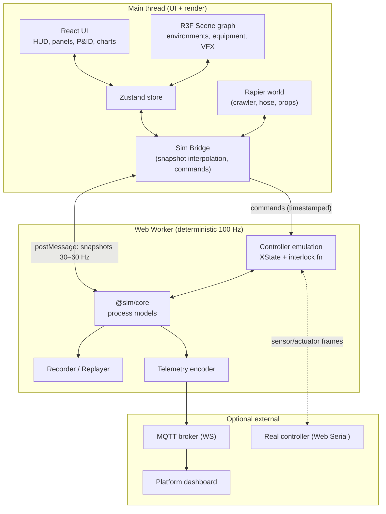
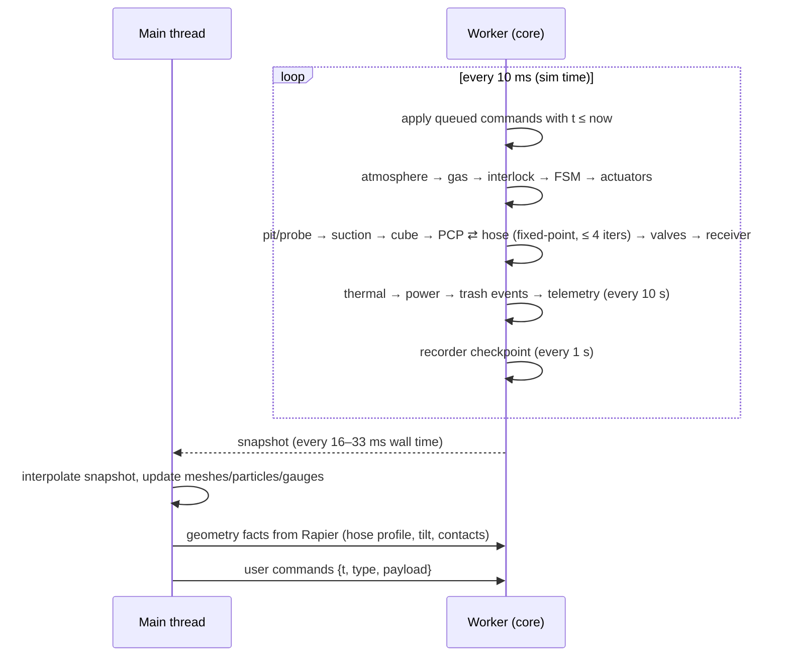
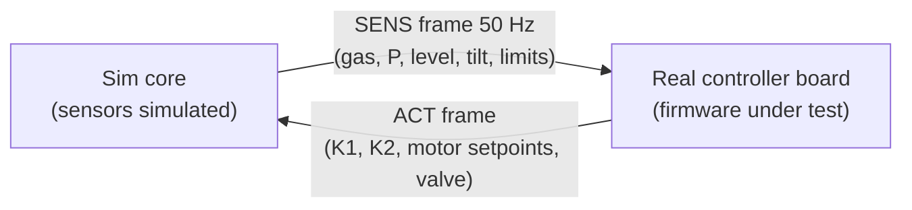

# Sim 02 · Architecture and Tech Stack

## 1. Tech stack

| Concern | Choice | Why |
| :--- | :--- | :--- |
| Language | **TypeScript** (strict) | Shared types between the physics core, UI and telemetry |
| Build / dev server | **Vite** | Fast HMR, worker bundling, static output |
| 3D rendering | **Three.js** through **React Three Fiber** + **drei** | Mature ecosystem, glTF, post-processing, WebGPU renderer path |
| Post-processing | `postprocessing` (SSAO, bloom, outline, tone mapping) | Highlights, alarm glow |
| Rigid-body physics | **Rapier 3D** (WASM, `@dimforge/rapier3d-compat`) | Deterministic, fast, heightfield and compound colliders |
| Process physics | **Custom TS core (`@sim/core`)** in a Web Worker | Our equations, unit-testable, renderer-independent |
| Job state machine | **XState** | Same statechart as [03 §5.2](../03-system-architecture.md#52-job-state-machine); visualisable |
| UI state | **Zustand** | Simple, works outside React (worker bridge) |
| UI components | React + Radix UI primitives + CSS variables | Accessible, themeable |
| Dev parameter panel | **Leva** | Sandbox sliders |
| Charts | **uPlot** | Very fast time-series for 100 Hz data |
| 2D P&ID overlay | SVG (hand-drawn symbols, ISA-5.1 style) driven by state | Crisp, live colouring |
| Audio | Web Audio API (+ Howler for loading) | Pump pitch follows rpm; alarms |
| i18n | i18next | EN / HI, then regional languages |
| Telemetry | `mqtt` (MQTT over WebSocket), optional | Same JSON as [07](../07-telemetry-and-digital-platform.md) |
| HIL | Web Serial API | Real controller in the loop |
| Testing | **Vitest** (unit), **Playwright** (e2e + visual) | CI-friendly |
| Assets | Blender → glTF 2.0 (`.glb`) + Meshopt/Draco + KTX2 (Basis) textures | Small, GPU-friendly |
| Hosting | GitHub Pages (static) + PWA (Workbox) | Free, offline-capable |

Pin exact dependency versions in `package.json` and update them deliberately.

## 2. Layered architecture



### Why the work is split this way

- **Process physics in a worker.** It is stiff and has algebraic loops, so it needs a fixed timestep. Running it off the main thread means the frame rate never affects results, which SIM-NFR-03 requires.
- **Rapier on the main thread.** Vehicle and hose motion is tightly coupled to rendering and input. Rapier runs its own fixed step (60 Hz) and sends *geometry facts* to the core each step: hose elevation profile, hose curvature, chassis tilt, and whether the outriggers touch the ground.
- **One-way dependency.** `@sim/core` has **no DOM or Three.js imports**. It can run in Node for tests, parameter sweeps and CI.

## 3. Module map (`@sim/core`)

```
sim/src/core/
├── units.ts             # SI helpers, bar↔Pa, L/min↔m³/s
├── params.ts            # typed loader for data/parameters.json (+ overrides)
├── rng.ts               # seeded PRNG (xoshiro128**) for determinism
├── solver.ts            # fixed-step scheduler, bisection / Newton helpers
├── models/
│   ├── atmosphere.ts    # P(h), ambient T, wind
│   ├── rheology.ts      # τy(TS,T), μp(TS,T), HB/Bingham helpers
│   ├── pit.ts           # stratified column, mixing, rathole, wall stability
│   ├── gas.ts           # headspace ODE, agitation release, blower, sensor lag
│   ├── probe.ts         # auger torque/current, screen blinding, jets, air-lift
│   ├── suction.ts       # suction-leg flow solve
│   ├── surgeCube.ts     # level, pressure, float, rock trap, vane pump
│   ├── pcp.ts           # flow, slip, torque, power, thermal, dry-run, NPSH
│   ├── hose.ts          # discharge network, fill front, kinks, friction
│   ├── valves.ts        # relief, 3-way, PRV, check
│   ├── receiver.ts      # tanker / drums
│   ├── thermal.ts       # lumped nodes, freezing, heaters
│   ├── power.ts         # battery SOC/OCV/temperature, genset, engine derate
│   └── trash.ts         # stochastic trash items, wraps, ingress
├── control/
│   ├── interlock.ts     # pure function = 05 §3 (single source of truth)
│   ├── jobMachine.ts    # XState statechart = 03 §5.2
│   └── pendant.ts       # operator command mapping
├── telemetry/encoder.ts # 07 §4 JSON
├── record/              # input log + periodic state checkpoints
└── index.ts             # createSim(scenario, params, seed) → SimHandle
```

## 4. Simulation loop



**Time scaling.** At ×N the worker runs N steps per real 10 ms, up to a CPU budget. If the budget is exceeded, the worker reports "sim lagging" and the UI caps the speed.

**Snapshot format.** Snapshots are a flat `Float64Array` with a fixed field layout generated from a schema, plus a small JSON block for discrete state (FSM state, alarms). They are sent as a transferable object, so there is no copying.

## 5. Determinism, recording and replay

- **Seeded RNG only.** `Math.random` is banned in the core; an ESLint rule enforces this.
- **Commands are timestamped** in sim time and applied at step boundaries.
- **Recording** is `{seed, scenarioId, paramsHash, commands[], checkpoints[]}`, typically about 50 KB for a 30 min session.
- **Replay** re-simulates from the seed and commands. Checkpoints allow scrubbing on the debrief timeline.
- **Rapier determinism:** use the `-compat` build with the same step and the same insertion order. Geometry facts sent to the core are recorded as inputs, so a core replay does not depend on Rapier.

## 6. Integration with the telemetry platform

- `telemetry/encoder.ts` produces `job.started`, `job.telemetry` (10 s batches) and `job.closed` messages that match [07 §4](../07-telemetry-and-digital-platform.md#4-message-formats-mqtt-json) exactly. A shared JSON Schema lives in `/platform/schemas/` and is used by both projects.
- Sinks:
  - in-app log panel
  - downloadable `.jsonl` file
  - MQTT-over-WebSocket broker (URL configured in settings)
- This lets the **platform dashboard be demonstrated live** while a judge "runs a job" in the simulation.

## 7. Hardware-in-the-loop (HIL) mode — stretch goal



- Uses the Web Serial API over USB-CDC. The frame format is COBS-encoded with CRC16.
- In HIL mode the simulation **replaces** its own `interlock.ts` and `jobMachine.ts` outputs with the board's outputs. The fault-injection test cases T4.x from [08](../08-test-and-validation-plan.md) can then be run automatically against the real firmware.

## 8. Rendering architecture

| Layer | Content |
| :--- | :--- |
| Environment | Terrain (heightfield + splat), buildings, stairs, vegetation (instanced), sky, fog, weather |
| Equipment | Crawler / handcart, skid, lance, tripod, hoses (dynamic tube geometry), tanker |
| Process VFX | Sludge layers (shader), flow particles (GPU instanced), gas plume (volumetric sprite), jets, air bubbles |
| Overlays | Cutaway clipping planes, X-ray material swap, heatmaps (TS, τ<sub>y</sub>, pressure along the hose), labels |
| UI | HUD, P&ID, charts, pendant, dialogs |

Quality presets switch shadow resolution, SSAO, particle counts, vegetation density, LOD bias and render scale.

## 9. Configuration and data

- `sim/src/data/parameters.json` holds the engineering defaults and mirrors [04 §8](../04-engineering-calculations.md#8-parameter-table-shared-with-the-simulation). It is validated by a Zod schema.
- `sim/src/data/scenarios/*.json` holds scenarios (schema in [06 §1](06-scenarios-and-training.md#1-scenario-file-schema)).
- `sim/src/data/i18n/{en,hi}.json` holds the UI strings.
- URL parameters (`?scenario=S02&mode=sandbox&seed=42`) let the team share exact setups.
