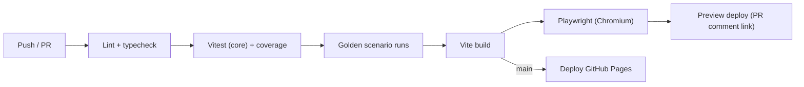

# Sim 07 · Implementation Plan, Repository Layout and Testing

## 1. Milestones

| MS | Name | Duration (2–3 devs) | Scope | Exit criteria |
| :--- | :--- | :--- | :--- | :--- |
| **M0** | Skeleton | 3 days | Vite + TS + R3F + Rapier + worker bridge, CI, lint, deploy to Pages | Empty scene deploys; worker ticks at 100 Hz; CI green |
| **M1** | Physics core | 10 days | `@sim/core`: atmosphere, rheology, suction, cube, PCP, hose, valves, interlock, FSM; headless runner | **All TS-1 tests pass** ([08 §9](../08-test-and-validation-plan.md#9-simulation-validation-sim--rig)); CLI sweep reproduces 04 tables |
| **M2** | 3D slice | 14 days | E1 terrain + stairs generator, crawler (Rapier), skid/lance/hose assets, pit cutaway, gauges, pendant, P&ID v1 | Drive to a pit, run S02 end-to-end, Medium preset ≥ 30 FPS |
| **M3** | Content | 10 days | Gas model + plume, pit mixing/trash, thermal, power, E2/E4 scenes, Training mode + scoring, S02–S09 | Training M2–M5 playable; debrief works |
| **M4** | Pitch-ready | 7 days | Compare mode, Demo script, Explore showroom, telemetry → MQTT → dashboard, EN/HI, polish, audio | Demo runs unattended for 5 min; Compare scorecard correct |
| **M5** | Calibrated | 4 days (after rig tests) | Load Stage 0–3 data, refit parameters, mark "calibrated" | TS-2/TS-3 within tolerance |
| Stretch | HIL, E3 scene, S10–S12, X-scenarios | as time allows | — | — |

### MVP cut line (if time is short)

Ship **M0–M2 + S02 + Compare mode + the Demo script**. That alone delivers the core pitch: the hill problem, the solution, the safety interlock and the physics proof.

## 2. Repository layout (`/sim`)

```
sim/
├── index.html
├── package.json            # exact versions pinned
├── vite.config.ts          # worker, wasm, PWA plugin
├── tsconfig.json           # strict
├── public/
│   ├── models/             # .glb (meshopt) — tracked with Git LFS
│   ├── textures/           # .ktx2
│   ├── audio/
│   └── manifest.webmanifest
├── src/
│   ├── core/               # @sim/core — NO DOM / three imports (lint-enforced)
│   ├── worker/             # sim.worker.ts, protocol.ts (snapshot schema)
│   ├── scene/              # R3F components: environments/, equipment/, vfx/, cameras/
│   ├── physics/            # Rapier world, crawler.ts, hoseRope.ts, stairs.ts
│   ├── ui/                 # hud/, pendant/, pid/, charts/, panels/, training/, debrief/
│   ├── modes/              # explore, sandbox, training, challenge, compare, demo
│   ├── telemetry/          # mqtt sink, jsonl export
│   ├── hil/                # web-serial transport, frame codec
│   ├── data/
│   │   ├── parameters.json
│   │   ├── scenarios/*.json
│   │   └── i18n/{en,hi}.json
│   ├── store/              # zustand slices
│   └── main.tsx
├── tools/
│   ├── sweep.ts            # headless parameter sweep (Node)
│   └── calibrate.ts        # fit τy/μp/slip from rig CSVs
└── tests/
    ├── core/               # vitest — physics oracles from docs/04
    ├── e2e/                # playwright — scenario smoke + screenshots
    └── fixtures/
```

## 3. Coding standards

- TypeScript `strict`, ESLint plus Prettier.
- Custom lint rules:
  - no `Math.random` in `core/`
  - no `three` or `react` imports in `core/`
- **Units in names**: `pDisch_Pa`, `q_m3s`, `tAmb_K`. UI converts at the edge.
- Every physics function has a JSDoc comment citing its equation, for example `@see docs/04 §4`.
- Parameters are never hard-coded. They always come from `params`.
- Every PR touching `core/` must keep coverage ≥ 90% and the oracle tests green.

## 4. Testing strategy

| Level | Tool | What | When |
| :--- | :--- | :--- | :--- |
| Unit / oracle | Vitest | Each equation vs [04](../04-engineering-calculations.md) tables; interlock truth table; FSM transitions | Every commit |
| Property | fast-check | Mass conservation (pit + cube + hose + receiver = constant ± ε); energy ≥ 0; monotonic hose ΔP(Q) | Every commit |
| Determinism | Vitest | Same seed and commands give an identical snapshot hash after a 30 min sim | Every commit |
| Scenario regression | Headless runner | S02–S09 scripted "golden runs": outcome metrics within tolerance | Every PR |
| E2E | Playwright | Load each scene, run the Demo, complete a Training step, screenshot compare (≤ 2% pixel diff) | Every PR (Chromium), nightly (all browsers) |
| Performance | Playwright + `performance` API | FPS and frame time on the CI GPU runner, or a manual check on reference laptops | Weekly / before release |
| Calibration | `tools/calibrate.ts` | Fit vs rig CSV; report R² | After each rig test |
| User testing | Think-aloud with 3–5 people (including a sanitation worker if possible) | Training-mode comprehension | M3, M4 |

## 5. CI/CD (GitHub Actions)



- Large binary assets are stored in **Git LFS**, and the CI job runs `git lfs pull`.
- A bundle-size check fails the PR if the initial JS exceeds 1.5 MB (gzip) or the total first load exceeds 25 MB.

## 6. Definition of done (per feature)

- [ ] Requirement ID(s) referenced in the PR
- [ ] Physics: oracle test added or updated and documentation section linked
- [ ] Works on the Low and Medium presets
- [ ] EN and HI strings added
- [ ] Keyboard accessible
- [ ] No console errors; worker step ≤ 1 ms
- [ ] Docs updated (this folder) if behaviour changed

## 7. Risks and mitigations

| Risk | Mitigation |
| :--- | :--- |
| Rapier crawler on stairs is unstable | Ray-cast suspension with tuned damping; a test course in CI; fall back to a kinematic "rail" mode for Demo |
| Hose rope with 300+ segments is too slow | Distance-based LOD (merge segments far from the camera), sleep segments at rest, physics only on the active section |
| GPU too weak on judges' laptops | Low preset auto-detected; a pre-rendered fallback video of the Demo bundled offline |
| Uncalibrated parameters look "made up" | Source tags in the UI (assumed / report / calibrated); a calibration screen showing rig vs sim |
| Asset creation bottleneck | Start with primitive / kit-bashed models; the CAD team exports simplified STEP → Blender → glTF from M2 onwards |
| Scope creep | MVP cut line (§1); feature freeze 5 days before the finale |

## 8. Bootstrapping commands (for M0)

```bash
npm create vite@latest sim -- --template react-ts
```

```bash
cd sim && npm i three @react-three/fiber @react-three/drei @dimforge/rapier3d-compat zustand xstate uplot leva i18next react-i18next zod
```

```bash
cd sim && npm i -D vitest @playwright/test fast-check eslint prettier vite-plugin-pwa @types/three
```

After installing, pin the resolved versions: commit `package-lock.json`, and use exact versions without `^`.
